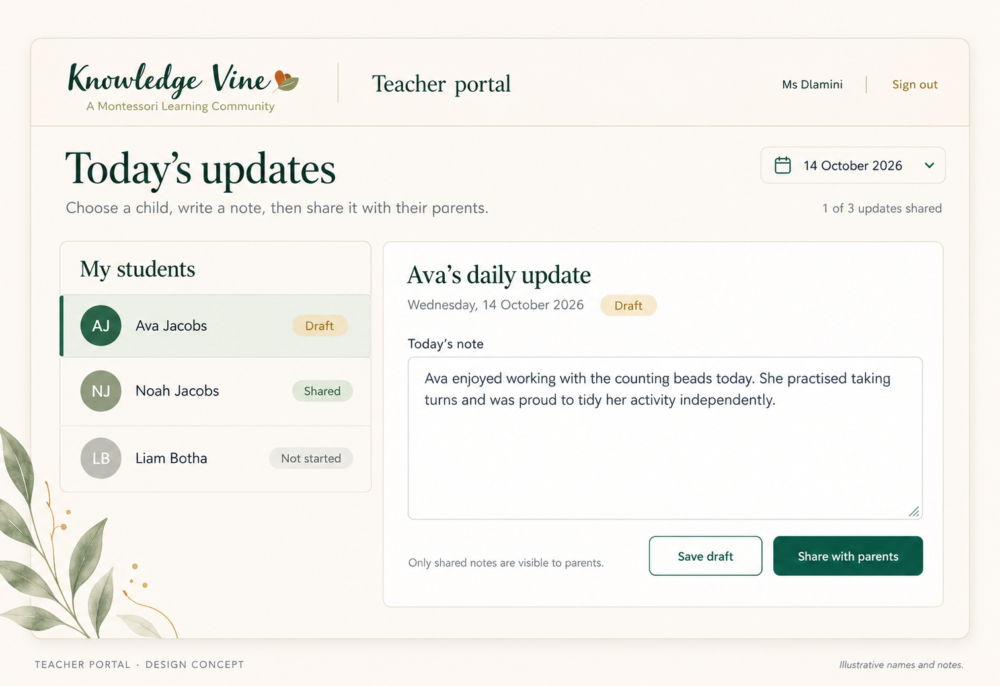
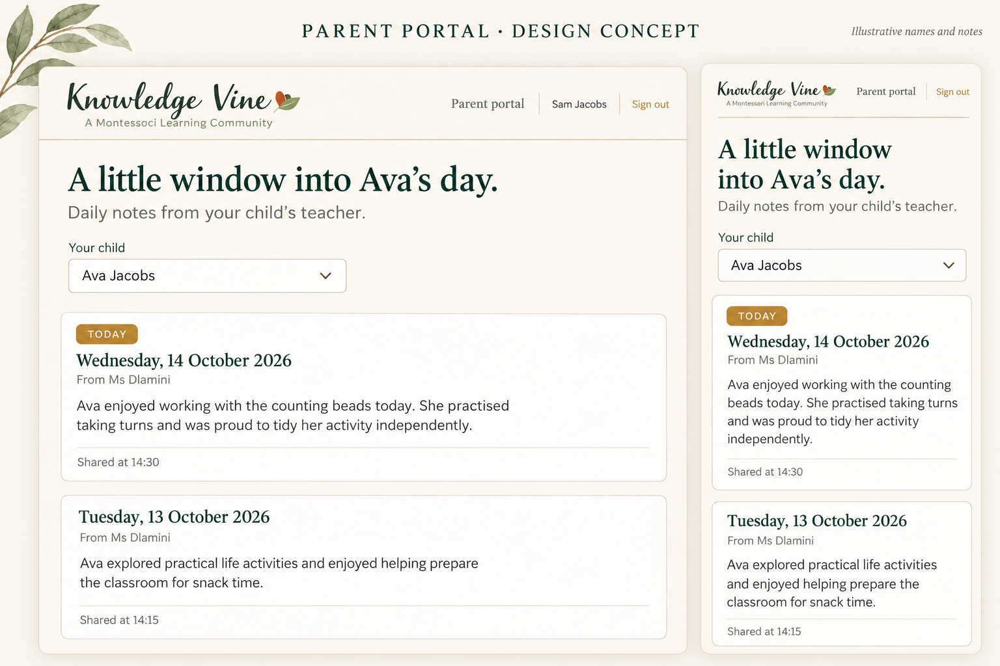
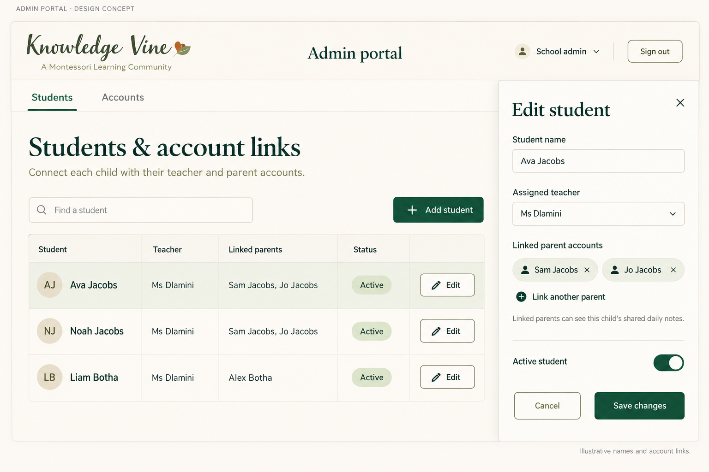
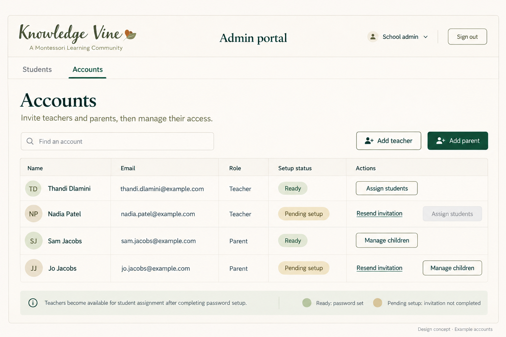
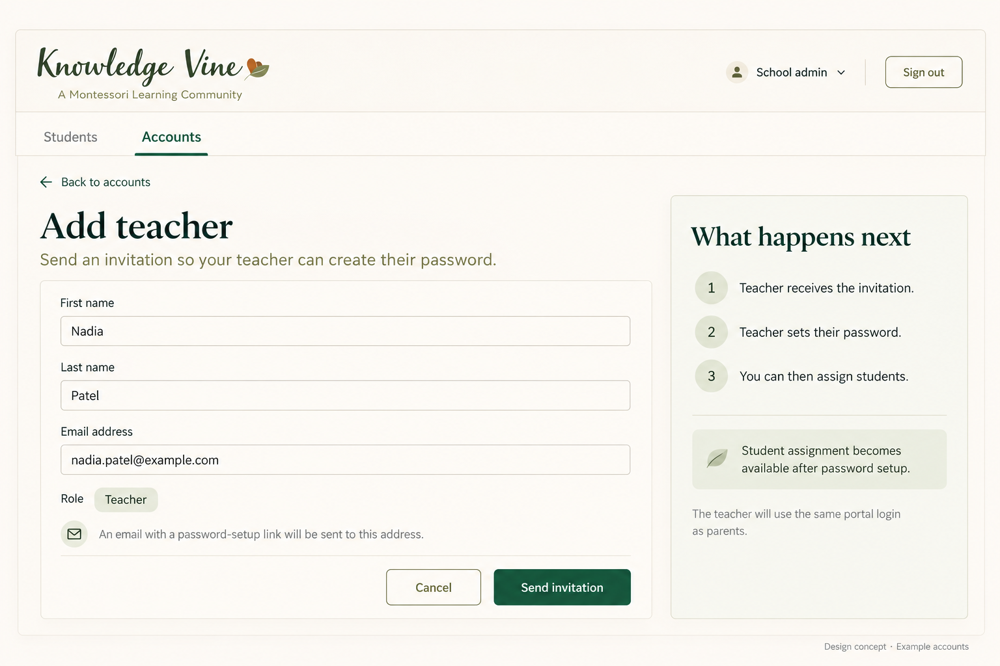
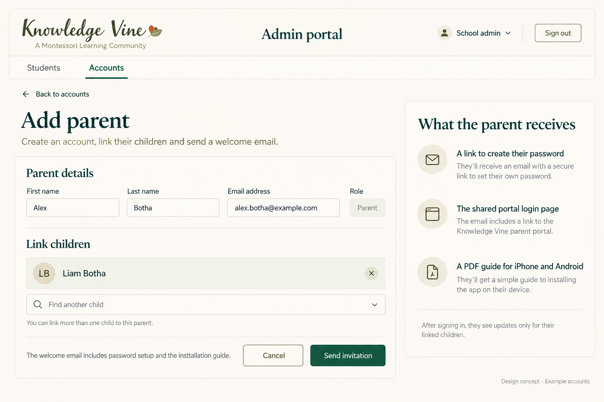

# Knowledge Vine portal implementation plan

Last updated: 15 October 2026. **First production deployment is complete and verified**, release `20261015-114126`. Steps 1–7 and step 8's PWA navigation fix now run on Erebor. Step 8's real iPhone/Android checks, native screenshots and final installation PDF/email link remain pending before family onboarding. The testing VM was not changed by this release.

The user explicitly authorized production deployment after confirming the existing local website backup. [The deployment record](portal-step-9-deployment.md) contains validation, backup and rollback evidence. KnowledgeVine retains ports 8082/8083, now bound to loopback, and has its own unpublished PostgreSQL 18.6 container/database and persisted authentication keys. Only KnowledgeVine resources and the reviewed school nginx virtual host were changed. A validated graceful nginx reload preserved the master process. All running/fallback/stopped GOTR container identities, configurations, mounts, ports, networks and start times match the predeployment baseline; protected files and shared host service identities are unchanged. No connection/query was made to host PostgreSQL or any GOTR database.

The original admin is ready in production using the email and initial password supplied by the user. No development/VM school records were copied. The database has one admin, no students and no notes. Initial and final KnowledgeVine-only database/key/config backups were restored successfully in isolated temporary containers, then encrypted off-server copies were saved under the user's local KnowledgeVine backup folder. Backups are currently manual; recurring scheduling/retention remains to be agreed before routine school use. No hard CPU/RAM limits were set.

This is the canonical implementation plan for the parent, teacher and admin portal. Earlier decision-log entries describe their own point in time; current production status is above. The database/account foundation, authentication, emails, admin management, teacher notes, parent feed and PWA are implemented, tested locally and deployed. Continue actual-phone HTTPS testing on the live portal, then finalize/publish the guide before parent onboarding. `Portal:Mail:InstallationGuideUrl` remains unset while the PDF is a draft.

## Confirmed decisions

| Topic | Decision |
| --- | --- |
| Feature scope | Daily student updates only for the first release. |
| Expected size and resource limits | At most 20 students. Start without hard container CPU/RAM limits; check actual usage after deployment and reconsider limits only if measurements justify them. No fixed limits were selected or applied. |
| Update content | One short written note; no structured meal, sleep or mood fields. |
| Users | Parent, Teacher and Admin views, with updates linked to students and students linked to parents. |
| Initial admin | `anrich@knowledgevinemontessori.co.za` is the original admin in local development, the testing VM and production. Use the initial password supplied privately by the user; do not put it in this document, source code or migrations. |
| Future admins | Additional Admin accounts may be added later through a controlled, authorized flow. The initial bootstrap is one-time; the application is not restricted to a single Admin forever. |
| Existing project | Extend the existing Angular website and .NET API. |
| Database | PostgreSQL through EF Core and Npgsql. This supersedes the initial SQLite suggestion. |
| Website entry | The existing Parent Portal navigation item becomes a real link to the shared login page. |
| Public login copy | Do not display the `PARENTS · TEACHERS · ADMIN` line or advertise admin access on the public sign-in page. Use generic school/portal wording while retaining the shared email login and server-enforced role checks. Preserve the user's template edit. |
| Phones | Use a browser-installable PWA that opens the portal, with normal browser access also available. |
| Parent onboarding | Admin creates the parent account using their email and links their children. The parent receives a welcome email with a password-setup link and instructions. After setting their password, they are redirected to login. |
| Teacher onboarding | Admin invites a teacher by email. The teacher sets their password and uses the same login page as parents. Admin can assign students only after the teacher has completed password setup. |
| Installation help | Provide a short PDF with screenshots for iPhone and Android. Include its download link in the welcome email; the school can also forward the PDF directly to parents. |
| Email delivery | Reuse the existing API EmailSettings SMTP configuration for parent invitations, teacher invitations, resends and password resets. No new email provider is required for this release. |
| Sessions | Sign out after 30 minutes of inactivity. No Keep me signed in option in version one, including on shared school devices. |
| Note history and parent access | Retain all dated notes. Parents can read only the current calendar year's shared notes for their linked enrolled children, using Africa/Johannesburg to determine the current year. |
| Leaving school | Parent access to a child's notes ends immediately when that child leaves. Access to any other enrolled children continues. Retain the departed child's notes for the school. |
| Note length | Aim for about three normal paragraphs. Retain the existing 2,000-character limit as the working implementation cap, roughly 300 words depending on wording; no exact paragraph-count requirement. |
| Initial setup links | Confirmed expiry of 24 hours, with the existing single-use and replacement-link rules. |
| Current work | First production deployment is verified. Complete actual iPhone/Android installation/standalone checks, then finalize the guide and its welcome-email link before onboarding families. VM remains unchanged; future VM deployments require explicit authorization. |
| Account deactivation | Deactivation revokes sessions and setup links, clears teacher assignments and retains parent-child links and note history. Reactivation does not restore teacher assignments automatically; a pending account needs a fresh invitation. Admin-role accounts are protected from deactivation in this first-version screen. |
| Existing email | Account creation returns a link to the existing account and displays its roles there. It never silently creates a duplicate or grants another role; explicit additional-role/admin management remains a later controlled flow. |
| Test invitations | Development-only private admin previews allow fictional-account onboarding without sending teacher/parent emails. Production ignores the preview override. Resets for the completed VM admin retain SMTP. |
| Backups | Deferred until release preparation, then implemented for production: manual database/key/config backups, isolated verified restores and authenticated encrypted off-server copies. Agree recurring schedule/retention before routine school use. |
| VM deployment approval | From 14 October 2026, develop and verify changes locally by default. Deploy to the testing VM only when the user explicitly gives the go-ahead for that deployment; earlier deployments do not authorize future ones. |
| Local database boundary | Use only `knowledgevine_local` on 127.0.0.1:5432, plus `postgres` for narrowly scoped provisioning. Never connect to or modify `GOTR_Live`. |
| Testing environment | Steps 1–7 run in `ubuntu24testenv` under `/home/anrich/KnowledgeVine`, after the user authorized provisioning/deployment. The installed OS reports Ubuntu 24.04.5 LTS. Keep each environment's KnowledgeVine database, credentials and authentication keys separate. See the VM deployment guide. |
| Server boundary | Any future deployment work stays in KnowledgeVine; do not access or modify the gotr client project or shared server configuration. SSH is currently disconnected. |

## Proposed working defaults

These make the design concrete but are not separate features requested by the user. Revise them here if the school chooses a different workflow:

- One note per student per South African school date, with Draft and Shared states.
- The teacher date selector defaults to the API's current Africa/Johannesburg date and accepts today or an earlier date; future notes are rejected. This is the step-5 working default, not a separate school policy confirmation.
- One assigned teacher per student initially; parents can link to multiple children and each child can link to multiple parents.
- Admin manages accounts and access links; no public parent registration or self-linking to students.
- ASP.NET Core Identity handles accounts and password setup/reset; authenticated API checks enforce access.
- Parent notes are read only. Teacher corrections retain author/editor metadata and show an Edited timestamp.
- Private notes require connectivity; application assets may be cached. Push notifications and private offline storage are outside version one.
- Aim for about three normal paragraphs within the existing working limit of 2,000 characters. Include a version field to detect conflicting saves.
- Cream, forest green and muted gold are the current design direction; mockups are concepts rather than pixel-final designs.

## Everyday workflow

1. Admin creates teacher and parent accounts and sends their invitation emails. Teachers complete password setup before admin can assign students to them. Admin adds student records and links the correct parent accounts; parent-child links may be prepared before the parent completes setup. Successful password setup redirects either role to the same login page. Parents do not register themselves or claim a child by name.
2. Teacher signs in, selects an assigned student and writes a note. **Save draft** keeps it private. **Share with parents** makes it available in the portal to that student's linked parents.
3. Parent signs in and sees the latest shared note first, followed by earlier dates. If they have multiple linked children, a child selector switches the feed.
4. A teacher can correct their shared note. Parents see an edited timestamp. The original author, last editor and relevant timestamps are recorded.

Sharing makes the saved note available; there is no separate copy to send to each parent. In this release, parents fetch updates when they open or refresh their portal. External update notifications and live delivery are later decisions.

## Parent invitation and password setup

The user explicitly confirmed this onboarding approach on 14 October 2026.

1. Admin enters the parent's name and email, assigns the Parent role, and links the correct student records. Create the account without a temporary password; it remains pending setup until the parent completes the invitation.
2. Send a welcome email from the school's configured mail service. Include the school name, the parent's sign-in email, a **Set up your password** link, brief next steps, the normal portal login link, a link to the latest installation PDF, and a school support contact. Keep student notes out of this email.
3. The link opens `/portal/setup-password`, with **New password** and **Confirm password** fields. The parent chooses their own password; passwords are never emailed.
4. On successful submission, validate the account-bound setup token, save the password through Identity, confirm the invitation email address and make the setup link unusable. Merely opening the link does not consume it.
5. Redirect to `/portal/login` and show **Your password is set. Please sign in.** Do not automatically sign the parent in during initial password setup.
6. The parent signs in, sees only their linked children and can install the PWA using the PDF guide.

Implementation defaults to retain in this plan:

- Setup links are expiring and single-use. The confirmed initial expiry is 24 hours; retain configuration support for future policy changes.
- Admin has a **Resend setup email** action for pending accounts, including cases where the original email failed or the link expired. A replacement setup link invalidates the earlier pending link. Completed accounts use the normal password-reset flow.
- Derive **Pending setup** from the existing Identity account fields; a separate invitations table is not needed for this first version. The account's active/deactivated flag remains a separate access control.
- Preserve the account and student links if sending the email fails, display a clear failure to admin and allow retry. Account creation is not proof of email delivery.
- Use the existing Identity token mechanisms and persistent protection keys. Do not store the raw invitation token or a plain-text password in a new table.

## Email delivery and templates

Confirmed on 14 October 2026: use the existing sending details in the API's appsettings configuration. The current service reads `EmailSettings:SmtpHost`, `EmailSettings:SmtpPort`, `EmailSettings:FromEmail` and `EmailSettings:Password`, and enables TLS for SMTP. Keep the credential values in application configuration; do not copy them into planning documents or email templates.

The shared SMTP transport now sends both contact and portal messages, reusing the existing settings. Contact enquiries retain the configured school recipient and Reply-To behaviour. Portal recipients come from registered accounts. See [email delivery configuration and verification](portal-email-delivery.md).

| Template | Recipient | Content |
| --- | --- | --- |
| Parent welcome/setup | Newly invited parent | Welcome, password-setup button, sign-in email, shared login link, installation PDF download link and school support contact. |
| Teacher welcome/setup | Newly invited teacher | Welcome, password-setup button, sign-in email, shared login link, and explanation that student assignment becomes available after setup. |
| Resent setup invitation | Pending parent or teacher | Role-appropriate setup instructions with a fresh link, using the same expiry and replacement-link rules. |
| Password reset | Existing account holder requesting recovery | Password-reset link and instructions using Identity's reset flow. |

Use the configured school sender address and a recognizable school display name. Provide a simple branded HTML template with a plain-text alternative. Choose the recipient from the registered account on the server. Daily notes remain in the portal; these account emails do not contain student updates. Reusing SMTP configuration does not change the single-use/expiry rules for links.

Rendering and SMTP failure handling are verified by automated checks and browser previews. Failed delivery does not report a successful send; pending accounts are preserved for retry. The user authorized one reset test to the original admin address, which SMTP accepted from the VM. Its password and security stamp were unchanged. No real parent/teacher invitations were sent. The installation PDF link is omitted until phase 8 publishes the guide.

## Teacher invitation and student assignment

Confirmed on 14 October 2026: use the same account invitation, password-setup page and login page for teachers and parents, with role-specific welcome text.

1. Admin opens **Accounts > Add teacher**, enters first name, last name and email, and chooses **Send invitation**. The form sets the Teacher role; admin does not enter a password or select students at this stage.
2. The teacher account appears as **Pending setup**. Admin may resend the invitation, but **Assign students** remains unavailable.
3. The teacher follows the email link, chooses and confirms their password, and is redirected to `/portal/login`.
4. When the teacher is active and setup is complete, the account shows **Ready** and appears in teacher-assignment controls. Admin can then assign students from the student's edit screen or the teacher's **Assign students** action.
5. The teacher signs in through the same login page and sees only their assigned students. Before assignment, show a friendly **No students assigned yet** state.

Here, **accepted** means successful password setup and email confirmation, not merely opening the invitation. A first login is not required before admin can assign students. The API enforces eligibility using the active flag, Teacher role and existing Identity setup fields; no new teacher-profile or acceptance table is needed.

## Revised admin account screens

Retain the Students and Accounts navigation and the current cream/green visual direction.

| Screen | Fields and actions | Behaviour |
| --- | --- | --- |
| Accounts | Account name, email, role, setup status; Add teacher, Add parent, Resend invitation and role-appropriate link management. | Ready teachers can be assigned students. Pending teachers cannot. Parent-child links can be prepared while a parent is pending setup. |
| Add teacher | First name, last name, email; fixed Teacher role; Cancel and Send invitation. | Creates the account and sends setup instructions. No admin-entered password and no student selector before setup completion. |
| Add parent | First name, last name, email; fixed Parent role; a child selector supporting multiple children; Cancel and Send invitation. | Creates the account, saves selected child links and sends password setup/login instructions with the installation PDF link. Children can also be linked later. |

Use **Pending setup** and **Ready** to describe onboarding completion. Account deactivation remains separate: a deactivated teacher is never eligible for assignment, even if their password was previously set. Invitation resend uses the previously defined expiry, single-use and replacement-link rules. Show mail failures clearly and retain the pending account for retry.

For an existing normalized email, return a clear existing-account result. Preserve a single identity per email and surface existing roles before any explicit role change; submitting a new invitation must not silently create a duplicate account or grant another role. The user model supports multiple roles, with the existing-account invitation interaction to be settled before implementation if needed.

## Three small views

| View | Included |
| --- | --- |
| Teacher | Assigned students, date selector, Draft/Shared/Not started status, one note field, Save draft and Share with parents. |
| Parent | Own linked children, latest shared note, previous shared notes, teacher name, date and edited timestamp when applicable. Read only. |
| Admin | Student list, account creation/deactivation, teacher assignment and parent links. Separate Students and Accounts tabs; Accounts includes Add teacher and Add parent forms plus invitation setup status and resend actions. |

A student can have multiple parent accounts. A parent can be linked to multiple students. Start with one assigned teacher per student; class management is unnecessary for this release.

## Session, history and leaving-school policies

Confirmed on 14 October 2026:

- Use a 30-minute inactivity timeout for Parent, Teacher and Admin accounts. Meaningful use renews the idle window; background refreshes must not keep an unattended session alive. Enforce expiry on the server. Version one has no Keep me signed in option and no persistent remembered login, including in the installed PWA. After expiry, require login again; preserve an unsaved teacher note in the current screen's memory during reauthentication, without private offline storage.
- Retain the entire history of dated daily-note records; do not delete notes at the end of the year or when a child leaves. This retains the previously agreed correction model: latest text with original-author, last-editor and timestamp metadata, rather than a full history of every text revision.
- Parents can access only shared notes whose `update_date` falls between 1 January of the current calendar year and 1 January of the following year, determined in Africa/Johannesburg. Apply the boundary to every parent read operation, including feeds, individual-note requests and any future export; interface filtering alone is insufficient. At New Year the visible year changes automatically while older notes remain stored. For example, during 2026 parents cannot retrieve 2025 notes.
- When a child leaves, admin marks that student inactive and the parent immediately loses access to that child's feed and individual notes. Retain the student, notes and relationships; their inactive state blocks parent access. Do not deactivate a parent's whole account merely because one child leaves: their access to other enrolled, linked children continues.
- Keep the existing assignment and correction rules: one active, setup-complete assigned teacher per student; only the current assigned teacher can save/share or correct that student's notes. A correction remains shared, preserves the original author and first-share timestamp, records the latest editor and shows Edited. Version checks prevent silent overwrites.
- Written updates should be about three normal paragraphs. The existing 2,000-character cap is a practical working limit, approximately 300 words depending on wording. Allow fewer paragraphs and do not require exactly three; give teachers a character counter and a clear limit message.
- Initial password-setup links expire after 24 hours. Successful setup consumes the link, resending replaces the old pending link, and successful setup redirects to the common login page.

Implementation boundary: step 2 enforces session expiry and password-link rules. Step 5 now holds the unsaved teacher note in the current tab's memory through expiry/API 401 and same-account login, then restores the child/date/text/version. A different login or explicit sign-out clears it. Closing/reloading loses the unsaved copy; Save draft persists it to the school. Leaving an unsaved editor or changing date asks before discarding. Version conflicts display the latest saved text separately and require an explicit choice before another save. Step 6 adds the current-year and active-student predicates through the new `ParentFeedAccess` migration, applied locally and on the explicitly authorized testing VM; the released migration resources are preserved. Parent APIs independently enforce the same rules for child lists, pages and individual notes. No additional school-data tables are required for these policies.

## Implementation approach

- Extend the existing Angular frontend with a shared portal layout and protected routes under `/portal`. A single login sends the user to their permitted view. Keep public marketing banners and the open-day popup outside the private portal.
- Extend the existing .NET API with account management, student links and daily-note endpoints.
- Use ASP.NET Core Identity for accounts, password handling and reset/setup tokens. Use secure HttpOnly authentication cookies, same-origin API requests and antiforgery protection for changes. Use supported, compatible framework and package versions when implementation begins.
- Use PostgreSQL, as confirmed by the school, with Entity Framework Core and the Npgsql provider.
- Make the portal installable as a PWA, with its home-screen entry opening `/portal/`. Keep private daily-note API responses online-only; cache application assets rather than student information. Parents can also use the portal without installation.
- Store the database and application authentication keys in persistent storage inside the KnowledgeVine deployment boundary, outside the replaceable publish/container files. Plan automated backups and verify a restore before launch. No existing client database or other project is involved.

## Database conventions

Use a dedicated KnowledgeVine database and database account. Lowercase snake_case names below are proposed mappings for both application and Identity tables. UUID account and student IDs are generated by the application. Foreign keys enforce valid record references; the API additionally checks account roles, active status and student access.

`timestamptz` columns represent instants written in UTC and displayed in South African time. `update_date` is a PostgreSQL `date`, determined using the school's Africa/Johannesburg time zone. Required fields are non-null unless explicitly marked nullable. Accounts and students are deactivated rather than removed through the normal admin interface. School-data foreign keys should not silently cascade-delete notes.

## 1. users

One account table for teachers, parents and admins, implemented as a custom ASP.NET Core Identity user. A teacher who is also a parent uses one account with both roles.

| Column | PostgreSQL type | Purpose |
| --- | --- | --- |
| id | uuid | Primary key. |
| first_name | varchar(100) | Account holder's given name. |
| last_name | varchar(100) | Account holder's surname. |
| email | varchar(256) | Sign-in and account-setup address. Required for this application. |
| is_active | boolean | Whether the account may access the portal; default true. |
| created_at | timestamptz | Account creation time. |
| updated_at | timestamptz | Last account change. |

Identity-managed columns in this same table:

| Column | PostgreSQL type | Purpose |
| --- | --- | --- |
| user_name | varchar(256) | Use the email as the Identity username. |
| normalized_user_name | varchar(256) | Unique normalized username lookup. |
| normalized_email | varchar(256) | Unique normalized email lookup. |
| email_confirmed | boolean | Whether the address has been confirmed. |
| password_hash | text, nullable | Framework password hash; empty until account setup. |
| security_stamp | text, nullable | Framework credential/session invalidation metadata. |
| concurrency_stamp | text, nullable | Framework account concurrency token. |
| phone_number | text, nullable | Standard Identity field; not collected in version one. |
| phone_number_confirmed | boolean | Standard Identity field. |
| two_factor_enabled | boolean | Standard Identity field. |
| lockout_end | timestamptz, nullable | Framework account lockout time. |
| lockout_enabled | boolean | Framework lockout setting. |
| access_failed_count | integer | Framework failed-login counter. |

Use Identity's password and setup/reset-token handling. Restrict account creation and role assignment to admin; do not expose public registration. Persist application protection keys so account-setup tokens and authentication cookies can survive container replacement as intended.

## 2. students

| Column | PostgreSQL type | Purpose |
| --- | --- | --- |
| id | uuid | Primary key. |
| first_name | varchar(100) | Child's given name. |
| last_name | varchar(100) | Child's surname. |
| teacher_user_id | uuid, nullable | FK to users; allows setup before teacher assignment. |
| is_active | boolean | Default true; inactive students stop appearing in new-note worklists. |
| created_at | timestamptz | Student creation time. |
| updated_at | timestamptz | Last student-record change. |

Before a teacher can write a note, the student must be assigned to that active teacher account. Student assignment itself requires the teacher to have completed account setup. Index `teacher_user_id` for teacher worklists. The API verifies the assigned account has the Teacher role, is active and has completed password/email setup. No additional child profile information or student login is needed.

## 3. parent_students

| Column | PostgreSQL type | Purpose |
| --- | --- | --- |
| parent_user_id | uuid | FK to users; one part of the primary key. |
| student_id | uuid | FK to students; the other part of the primary key. |
| linked_by_user_id | uuid | FK to the admin account that created the link. |
| created_at | timestamptz | When access was granted. |

Composite primary key: `(parent_user_id, student_id)`. Add an index on `student_id` for student-to-parent lookups. The API verifies the linked account has the Parent role. Removing a link revokes that parent's access to that child's feed. This table supports siblings and separate guardian accounts without duplicating student records.

## 4. daily_updates

| Column | PostgreSQL type | Purpose |
| --- | --- | --- |
| id | uuid | Primary key. |
| student_id | uuid | FK to students. |
| update_date | date | The school day the note describes. |
| note_text | text | Plain written note; target about three normal paragraphs, with a working maximum of 2,000 characters. |
| status | varchar(16) | Restricted to `draft` or `shared`. |
| created_by_user_id | uuid | FK to users; original author. |
| updated_by_user_id | uuid | FK to users; most recent editor. |
| created_at | timestamptz | First save time. |
| updated_at | timestamptz | Most recent save/share time. |
| shared_at | timestamptz, nullable | First share time; null for drafts. |
| version | integer | Incremented on changes to detect conflicting saves. |

Rules:

- Unique `(student_id, update_date)` prevents duplicate daily notes and supports chronological child-feed lookups.
- Shared notes require nonblank text and a non-null `shared_at`. Drafts have a null `shared_at`.
- A parent query requires an active, setup-complete account, a matching parent_students link, an active enrolled student, `status = shared`, and an `update_date` in the current South African calendar year. Older notes remain stored but are excluded from parent reads.
- Write requests require the active assigned teacher. Author/editor IDs come from the authenticated account, not user-entered form data.
- On initial sharing, use the same instant for `updated_at` and `shared_at`. Later content edits advance `updated_at`, preserve `shared_at` and show an Edited label. Only the latest note text and last-edit metadata are stored in this release, not a full revision history.
- Check `version` when saving; a conflicting edit asks the teacher to reload instead of silently overwriting newer text.
- No copies per parent, attachment records, read-receipt records or notification records are needed.

## Identity account-support tables

Keep the standard email/password Identity model and map its names consistently. These are framework infrastructure, not additional portal features. This proposal uses the standard schema without optional passkey storage.

| Table | Columns | Keys / purpose |
| --- | --- | --- |
| roles | id uuid; name varchar(256); normalized_name varchar(256); concurrency_stamp text nullable | PK id; unique normalized_name. Seed Admin, Teacher and Parent. |
| user_roles | user_id uuid; role_id uuid | Composite PK; FKs to users and roles. Allows multiple roles per account. |
| user_claims | id integer identity; user_id uuid; claim_type text nullable; claim_value text nullable | PK id; FK to users. |
| role_claims | id integer identity; role_id uuid; claim_type text nullable; claim_value text nullable | PK id; FK to roles. |
| user_logins | login_provider varchar(256); provider_key varchar(256); provider_display_name text nullable; user_id uuid | Composite PK on provider and provider_key; FK to users. Remains unused unless external login is later added. |
| user_tokens | user_id uuid; login_provider varchar(256); name varchar(256); value text nullable | Composite PK on user_id, login_provider and name; FK to users. Framework token storage where required; not a dedicated invitation log. |

Identity's exact framework-generated column details should be confirmed in the first migration for the selected supported package version. EF also manages its migration-history table: `__EFMigrationsHistory`, with `MigrationId` varchar(150) and `ProductVersion` varchar(32). Parent links and daily notes remain the application's own tables.

## Login and website entry

Use `https://www.knowledgevinemontessori.co.za` consistently for portal, installation and account-setup links. Keep portal API requests on the same origin so cookie authentication has a consistent host.

| Entry / route | Behaviour |
| --- | --- |
| Public website Parent Portal navigation item | Links to `/portal/login`. |
| `/portal/login` | Email/password login, setup/reset flow, then redirect using account permissions. Signed-in users continue to their permitted view. |
| `/portal/setup-password` | Validate the emailed initial-setup link, let the invited parent or teacher choose and confirm their password, then redirect to `/portal/login` after success. |
| `/portal/` | Installed-app launch entry; resolve session and route to login or permitted portal. |
| `/portal/parent` | Read-only feed for linked enrolled children and the current South African calendar year; implemented and verified locally and on the testing VM in step 6. |
| `/portal/teacher` | Protected Teacher entry now; assigned students and daily-note editor in step 5. |
| `/portal/admin` | Protected Admin entry now; account and student-link management in step 4. |

If an account has multiple roles, show only its permitted destinations, with a simple view switch. The API independently enforces every role and student-access check. Keep the public open-day popup and promotional header/footer out of portal screens.

Public sign-in copy must not list Parent/Teacher/Admin roles or explicitly advertise admin login. The user removed that line from the working template on 14 October 2026. This is a presentation decision; authentication, role authorization and the shared login remain in place. The current HTML comment also includes the welcome heading and sign-in introduction because those elements share the same source line; preserve the edit unless the user requests a layout adjustment. Step 3's VM redeployment now includes this edit.

The user supplied an updated crest logo on 14 October 2026. Website and portal headers use its transparent horizontal adaptation, preserving the green/gold vine crest and open book. Phone login headers centre the mark above the form. See [the saved logo and generation prompt](portal-brand-logo.md). Email templates currently retain their text wordmark.

## Getting it onto phones

Make the private portal an installable Progressive Web App called **Knowledge Vine Portal**, with school branding and an app icon. Its launch URL and manifest scope point to `/portal/`, with standalone display. It is served over HTTPS. Parents can install it through their browser without an app-store submission, or keep using it as a normal website.

Suggested assisted onboarding:

1. Admin creates the account, links the correct children and sends the welcome email with an expiring password-setup link and installation PDF link.
2. Parent sets their password, is redirected to login and signs in. A generic portal QR code is also useful for in-person installation help; it does not grant account access.
3. Show an Install app action where the browser offers an install prompt, or short device-specific instructions.
4. iPhone: open in Safari, use Share, choose Add to Home Screen, keep Open as Web App enabled where shown, then Add.
5. Android Chrome: open the three-dot menu, then Add to Home screen and Install app, or Install app directly if offered. Follow the installation prompt. Exact wording varies by version.
6. Test launching from the new home-screen icon and signing in if needed. A valid saved session goes to the permitted portal; an expired session returns to login. Do not assume a browser login will always transfer unchanged into the installed app.

## Parent installation PDF

Confirmed deliverable: a short, branded PDF that the school can send to parents, with screenshots showing installation from the browser.

- Target two pages: one for iPhone/Safari and one for Android/Chrome, with a short account-setup reminder and portal address/QR code.
- Explain browser installation step by step, opening the new home-screen icon, signing in if required, and where to find support. Parents should also understand that normal browser use remains available.
- Capture actual screens from the implemented portal and real phone installation flows using demonstration accounts. Do not publish real parent/student information, passwords or personal invitation links in screenshots. Record the tested browser/platform versions because menu labels can change.
- Finalize the PDF after the portal and installation flow have been verified on actual phones. Step 8 has a clearly marked two-page [review draft](../output/pdf/knowledge-vine-phone-guide-draft.pdf), using a labeled desktop-browser capture at phone width. The draft is not for parent distribution and stays outside public assets until actual phone captures, HTTPS address and device checks are available.
- Publish a stable download link for the latest guide and include it in the welcome email. Also give the school the PDF file for direct forwarding. This guide does not require additional account or database tables.

## PWA boundaries for version one

- Cache only application assets such as layout, scripts, styles and icons. Exclude authenticated account, student and note API responses from service-worker caching and use no-store responses for private API data.
- Daily notes and account actions require an internet connection. Offline, show a clear connection message; do not queue teacher shares or retain a private offline student feed.
- Fetch fresh notes on opening/returning to the parent feed and provide a refresh action.
- Handle application updates with a New version available prompt at a safe point. Do not force-reload a teacher's unsaved note. Test repeated deployments so parents do not get stuck on an old build.
- Installing the PWA does not create automatic push alerts. Push subscriptions, notification permissions and delivery are a separate future feature.
- Validate installation, session expiry, logout, offline behaviour and application updates on actual iPhone Safari and Android Chrome devices. These actual-device checks remain step 8; the HTTP loopback VM supports desktop PWA checks only. The implementation and VM browser/worker checks are complete in step 7.
- The user subsequently chose the first controlled live HTTPS deployment as the phone-testing environment. Complete the remaining device checks and final guide before real-family onboarding; a separate HTTPS testing hostname is no longer a prerequisite for that first deployment.

## Initial admin bootstrap plan

Implemented and run locally on 14 October 2026. The original account is `anrich@knowledgevinemontessori.co.za`, active, email-confirmed and assigned Admin. Identity verified the supplied password against the stored hash. A second command run preserved every account field, including the hash/security stamp; there is one persisted user and no students. This is the first Admin account, not a permanent single-admin restriction. No email, VM or production operation was performed.

Run from the repository root:

```bash
ASPNETCORE_ENVIRONMENT=Development dotnet run --project KnowledgeVineAPI/KnowledgeVineAPI --no-launch-profile --artifacts-path /tmp/knowledge-vine-portal-build -- --bootstrap-admin
```

First creation prompts twice for the password without echoing it; an existing admin returns a preserved-account result without asking for a password. Defaults are the email above and display-name fields `Anrich` / `Admin`; `--email`, `--first-name` and `--last-name` are available for explicit setup. Password arguments are rejected. Redirected protected input can supply the two password lines without putting a password in command arguments. Creation uses the runtime database login rather than a PostgreSQL administrator. The command exits after setup and starts no HTTP server.

1. Add an explicit operator-only command to the KnowledgeVine API, run from a local terminal initially and from KnowledgeVine's own API container in the VM/production. Configure the initial email above and collect the account's display-name fields at setup. Validate the configured KnowledgeVine database before connecting. Do not expose bootstrap as an HTTP registration endpoint or automatic startup seed.
2. Supply the user's chosen password through a hidden terminal prompt or protected environment-specific secret input. Use Identity's `UserManager.CreateAsync(user, password)` to validate and hash it, grant Admin, and make the account active. The trusted owner/operator bootstrap confirms this owner-specified email so the account is ready to use the common login; no initial invitation email is required for this account. Store only Identity's password hash in the database. Do not copy the password into source, migrations, planning documents, command-line arguments or logs, and do not substitute a generated password for the user's chosen value.
3. Check existing accounts before requesting a password. Collect human input without a database transaction/lock, then recheck and create/grant in a transaction protected by a database-scoped advisory lock. Count existing admin **accounts**, including pending/inactive accounts, rather than the already-seeded Admin role. Refuse to create another bootstrap admin or silently promote an existing parent/teacher account. Reruns and application restarts must not overwrite credentials, reset passwords or alter established admin accounts.
4. Create the original admin independently in each KnowledgeVine environment using the same initial email and user-supplied password, with separate databases/configuration. Do not copy development user/student data into production. The owner can subsequently use normal password-reset/change functionality; startup and deployment must preserve any later password change.
5. Verify initial password validation, login and admin-only access, plus duplicate/concurrent execution, an existing-email conflict and bootstrap after an admin already exists. Keep authorization based on the Admin role, rather than hardcoding all admin access to this email. Additional admins can be added later through an explicitly authorized account/role-management flow; that is separate from first-admin bootstrapping.

Bootstrap record creation belongs to the foundation; browser login is verified with phase 2's authentication pages. Parent and teacher invitations still use their agreed 24-hour password-setup flow. Production bootstrapping remains confined to KnowledgeVine and does not use the PostgreSQL superuser as an application login.

## Backup and restore plan

The user deferred backups during local/VM development until going live. With production deployment authorized, added KnowledgeVine-only manual backup and isolated restore verification helpers. Both initial and final production recovery sets passed; authenticated encrypted off-server copies are saved locally. See [the release record](portal-step-9-deployment.md) and [operator instructions](../deploy/production/README.md). Never connect these helpers to host PostgreSQL or GOTR.

The database, Data Protection keys and private environment/release/school-proxy configuration are backed up together. The encryption recovery key is stored separately from the encrypted archive and must be retained privately. No recurring job or automatic retention/deletion policy is configured yet; settle these before routine school use. No old website backup, GOTR backup or database volume was removed.

## Deployment boundary

Plan a dedicated PostgreSQL service for KnowledgeVine, with its own database account, persistent storage and backups. Keep it on the KnowledgeVine Docker network without a public database port. Database migrations, backup restoration and application authentication-key persistence are part of the implementation/deployment plan. The user authorizes read-only inspection anywhere on Erebor, including GOTR. Deployment writes remain scoped to KnowledgeVine and the specifically reviewed school nginx change after deployment authorization; GOTR and existing host PostgreSQL configuration/data/services are protected.

The user now chooses when a development batch is deployed to the testing VM. Local implementation and verification do not trigger deployment automatically. Wait for explicit authorization before uploading builds or applying VM changes.

Resource sizing decision: the user expects at most 20 students and prefers no hard container CPU/RAM limits initially. Leave those limits unset for the first release, retain local application builds and verify actual resource use after deployment. The earlier optional limit proposal is not a deployment prerequisite. No server setting was changed for this planning decision.

Erebor's read-only inspection confirmed `/root/KnowledgeVine`, Compose project `knowledgevine`, its separate `172.20.0.0/16` bridge, web port 8083 and API port 8082. Host nginx already routes the school HTTPS website and `/api/` to those ports. The school vhost is missing `X-Forwarded-Proto`; both Docker ports are also publicly reachable over HTTP. The proposed release keeps the port numbers but binds them to loopback, adds the school-only forwarding header and uses explicit loopback upstream addresses. These changes and a validated graceful nginx reload must be included in the reviewed deployment procedure; none were applied during inspection. The initial inspection left GOTR's site unread, then the user expanded read-only access and its actual routes/runtime/database dependencies were checked. GOTR remains outside deployment writes/actions. See [the inspection report](portal-production-inspection.md) for both stacks, active/fallback ports, KnowledgeVine's .NET 9 baseline and absent portal database/key storage, shared-resource constraints and preservation checks.

### .NET 10 deployment isolation

The local KnowledgeVine API and tests were upgraded from `net9.0` to `net10.0`; EF Core/Identity and Npgsql packages were selected for .NET 10. The Linux x64 publish profile also targets .NET 10 and remains self-contained. No live-server .NET installation, Docker image, container or GOTR configuration was changed during local setup.

At release, choose and verify the KnowledgeVine publish/launch mode explicitly. A framework-dependent API needs .NET 10 in its own runtime image, such as `mcr.microsoft.com/dotnet/aspnet:10.0`. A self-contained publish includes its runtime and is launched through the published executable, with suitable OS dependencies; the saved profile does not prove that the server's current Dockerfile uses this launch mode. Review only KnowledgeVine's Dockerfile and Compose configuration before choosing the final image and entry point.

Scope image builds and service recreation to KnowledgeVine. Preserve GOTR's existing images, containers, runtime versions, networks and volumes. The wider inspection confirms both running GOTR APIs already have .NET 10.0.12; its legacy .NET 9 Dockerfile does not describe those release containers. KnowledgeVine's runtime remains isolated in its own image. Do not replace host-wide .NET installations, restart the Docker daemon, run server-wide cleanup/down commands or alter unrelated/shared-global server configuration. The reviewed school-only nginx forwarding/upstream change and graceful reload require deployment authorization and checks of both sites. Keep KnowledgeVine's prior image available for rollback and verify its health after release.

## Essential behaviour to verify

- Parents cannot read another student's notes by changing a URL or request ID. Teachers can work only with their assigned students. These checks happen in the API as well as the interface.
- Drafts never appear in parent responses. Sharing blank text fails. A failed save/share preserves the typed note and shows a clear error rather than claiming success.
- Multiple parents receive access to the same shared record; siblings appear under the same parent's account. Removing a link or deactivating an account removes access.
- Parent reads enforce the current calendar year on the server. Test older notes, individual-note IDs, and the Africa/Johannesburg New Year boundary while preserving stored history.
- Marking a child inactive immediately denies parent reads for that child while preserving access to another enrolled sibling. Existing authenticated sessions must not bypass this check.
- Verify 30-minute idle expiry, renewal during meaningful activity, background refreshes, reauthentication with an unsaved note, and the absence of remembered login on school devices and the installed PWA.
- Refreshing and rebuilding the containers do not lose saved notes or accounts.
- A friendly empty state handles days without a shared note. The three views work on phones, with readable text and comfortable controls.
- The welcome email leads to password setup, successful setup redirects to login, and only a subsequent valid login opens the parent feed. Test expired, invalid and reused setup links, resend behaviour and failed email delivery.
- Teacher invitations use the same setup/login flow. Pending teachers are unavailable in student-assignment controls, and the API rejects assignment until setup is complete. Test assignment again after setup, after deactivation and with an account lacking the Teacher role.

## Implementation status

Step 9's first production deployment is complete and verified; see [the release record](portal-step-9-deployment.md). All 131 backend, 103 frontend and 5 production-worker checks passed before release. Live admin login, protected endpoints, HTTPS cookies, account/session persistence, asset hashes and isolated backup recovery passed. GOTR preservation comparisons passed. Real phone tests and final guide publication remain pending; recurring backup scheduling/retention is not configured.

Step 8's **local verification is complete; actual-phone checks and final guide publication are pending**, with [the results and remaining checks](portal-step-8-testing.md). The user confirmed there is no phone-accessible HTTPS preview and requested local checks first. Added three complete HTTP workflows covering invitation/setup/readiness, draft/share/correction, family/teacher isolation, departure, mail retry and API host recreation using the same PostgreSQL connection and persisted test keys. **131 backend, 103 frontend and 5 production-worker tests pass**, with a clean production build. A new fresh-navigation check found and fixed a service-worker path issue: Angular matches paths relative to the `/portal/` scope, so the redundant `/portal/**` navigation pattern missed cached-shell fallback. The corrected pattern stays within the registered portal scope; private APIs remain network-only. This fix was subsequently included in production release `20261015-114126`; the VM remains on its earlier release. Both pages of the branded installation-guide review draft were rendered/visually inspected; native phone captures have not been invented. The final stable guide path is `/guides/knowledge-vine-phone-guide.pdf`; it is not published and `Portal:Mail:InstallationGuideUrl` stays unset until the real PDF/download is verified. Original local rows, migrations and key files match their pre-test fingerprints. No VM, production/GOTR, real SMTP, migration, bootstrap or backup work was performed.

Step 7 is complete locally and deployed/verified on the VM, with [its testing guide and screenshots](portal-step-7-testing.md). Added a portal-scoped standalone manifest, school app icons, install-help/native-prompt fallback, online-only private APIs, offline clearing/recovery messages, phone safe areas/input/touch sizing and user-controlled app updates. A strict public-asset cache and explicit API bypass exclude private responses and queued writes. Reload waits for unsaved teacher/recovery text, dirty forms/child links, memory-only setup/reset links, sign-out/account actions and in-flight writes. All 103 frontend tests and 4 genuine production-worker integration tests pass; production builds remain within budget. VM browser verification covered native worker registration and a second deployment: an unfinished form blocked the update, then a safe user-initiated reload succeeded. Only the web service/assets and its nginx worker/manifest headers changed. All existing rows, keys, migrations, API/private configuration and API/database container IDs match their baseline. No accounts/notes or real emails were created. Actual iPhone/Android installation/standalone checks and the PDF remain step 8 with an HTTPS preview.

Step 6 is complete **locally and deployed/verified on the testing VM**, with [its testing guide and screenshots](portal-step-6-testing.md). The read-only parent feed supports child switching, full written notes, original teacher/latest correction details, refresh, empty/failure states and cursor pages of 20 notes (maximum 50 per API request). Every read enforces ready Parent status, links, enrollment, shared status and the current South African calendar year as applicable. Direct-note reads have the same boundaries. The new `20261015065839_ParentFeedAccess` migration replaces only the parent SQL helper; older notes remain stored and released migrations remain unchanged. All **127 backend and 87 frontend tests pass**, with no skipped backend tests and a clean production frontend build. Local browser checks cover sibling feeds, paging, corrections, departure while signed in, sign-out and desktop/390px layouts. Fictional records were removed afterwards. The user subsequently authorized VM deployment; its API/UI/SQL checks passed, all disposable records/tools were removed, and preexisting rows/settings/keys/database container match the recorded baseline. No production work, real email or backup work was performed.

Parent data stays in current-view memory. Switching children, failed access checks, expiry, sign-out or identity changes clears it; late responses cannot repopulate another child/account. Hidden tabs clear rendered child names/notes, then refresh access on return while remembering the selected child ID only in memory. Focus/manual refresh rechecks access without background session renewal. The server-defined New Year boundary clears and reloads the feed without relying on the phone wall clock. Revocation denies subsequent reads immediately; already delivered content clears on refresh/focus/hiding/expiry/sign-out. There is no real-time recall or polling in this version.

Step 5 is complete locally and deployed/tested on the VM, with [its testing guide and screenshots](portal-step-5-testing.md). Teacher-only APIs return assigned/enrolled children and daily editors; writes recheck the actor and lock the child, reject stale versions and use existing note triggers. The interface supports private drafts, sharing confirmation, shared corrections, conflict comparison and same-account recovery of typed text after reauthentication. All 117 backend and 69 frontend tests pass. Local and VM browser checks covered the teacher flow and 390px layouts. VM checks also verified reassignment during recovery, new-teacher corrections, cross-teacher isolation, Parent denial and CSRF/date/length boundaries. After cleanup, fingerprints confirm the original VM admin and existing student are unchanged. Only API/web containers were recreated; the database container, appsettings and authentication keys were preserved. No migration, admin bootstrap or real email was needed.

Phases 1–4 are implemented locally and deployed to the testing VM under the user's authorized scope. See [local setup and verification](portal-local-development.md), [email delivery](portal-email-delivery.md), [step-4 manual testing](portal-step-4-testing.md), [VM deployment and verification](../deploy/vm/README.md) and [the exported schema](../KnowledgeVineAPI/KnowledgeVineAPI/Data/Migrations/portal-schema.sql) for reproducible details. VM health/schema/deep-link checks pass. On 15 October 2026 the user signed in with their current password; authenticated VM checks verified creation/linking, pending-teacher restrictions, private previews/resends, duplicate-email protection, deactivation/reactivation, retained enrollment links, stale-save protection and 390px account cards. Only the fictional test records/previews were removed afterwards; the original admin and signed-in session were preserved.

- Step 4 adds protected Students/Accounts navigation, fixed-role Add teacher/Add parent forms, pending/ready/inactive states, resends, parent-child management, ready-teacher assignment and enrollment/deactivation controls. API authorization, CSRF and database readiness/link rules enforce these actions; duplicate emails cannot grant extra roles. Cross-screen link snapshots and record versions reject stale saves. No migration, new table or modified released SQL function was needed.
- All 109 backend and 50 frontend tests pass. New checks cover permissions, atomic creation/linking, delivery-failure preservation, setup-before-assignment, resend replacement, session revocation, concurrent edits, retained notes, multiple roles without implicit parent links and private/expired/production-preview boundaries. Local browser checks created fictional parent/teacher/child records, verified pending links and private previews/resends, and checked desktop/390px layouts.

- Created `knowledgevine_local`, with separate `knowledgevine_migrator` and `knowledgevine_app` logins. Development secrets and protection-key storage are outside Git. No `GOTR_Live` connections or changes were made.
- Added the ten planned Identity/school tables plus EF migration history, three seeded roles, thirteen functions and five triggers through two versioned EF migrations. There is one real account: the original admin. There are no student records.
- Enforced teacher readiness, parent links, private drafts, the provisional 2,000-character note limit, first-share/original-author preservation and version checks. Runtime EF updates retrieve generated timestamps/version and reject stale saves.
- Added a Development-only database readiness endpoint and PostgreSQL checks alongside the existing contact regression tests. School-data tests roll back their fictional records; bootstrap/authentication tests use session-local temporary Identity tables and preserve the real admin. No schema changes were needed for bootstrap or authentication.
- Updated the API/tests and Linux x64 self-contained publish profile to .NET 10 to match the installed development runtime. Later deployment must use an appropriate KnowledgeVine-only runtime image/launch mode; no server changes have been made. GOTR's runtime remains independent.
- Recorded the confirmed full note retention, current-year-only parent access, immediate access revocation when a child leaves and three-paragraph writing target. Step 6 now implements the year/active-student parent-feed filter through a third migration, applied locally and on the explicitly authorized testing VM.
- Implemented and ran `--bootstrap-admin` against `knowledgevine_local` using the supplied password through hidden input. Password hash/role/readiness checks pass; repeating the command preserves the whole account. Backup/restore work is deferred until release preparation, alongside production database/key volumes.
- Implemented shared Angular login, password help, initial setup/reset and protected Admin/Teacher/Parent entry screens. The website's Parent Portal link opens login. Private screens exclude the public navigation, footer, promotion banner and open-day popup. Portal and public pages load on demand.
- Implemented nonpersistent HttpOnly cookies, Secure cookies outside Development, same-origin API requests, CSRF protection, no-store responses and server-enforced 30-minute expiry. Only explicit foreground user activity renews the session. Each authenticated request rechecks account readiness, security stamp and roles; deactivation, password changes and changed roles revoke existing access. No remembered login or private browser storage is used.
- Implemented 24-hour initial setup tokens, replacement pending links, single-use completion and password reset through Identity. Completion returns to login without automatically signing in. Setup/reset links carry the token in a URL fragment, which the screen removes from history and retains only in memory. Five failed logins lock an account for 15 minutes; successful password recovery clears the lockout. New passwords require 12–128 characters with uppercase, lowercase, a number and a symbol.
- Implemented branded parent/teacher welcome, resend and reset HTML/plain-text emails, using a shared MailKit SMTP transport with mandatory TLS and existing school settings. Local development defaults to owner-readable private previews. Production does not fall back to preview on missing configuration. Server-side invitation services validate the registered role/recipient and preserve pending accounts on delivery failure. The future PDF link is optional and omitted until published.
- All 90 backend and 38 frontend tests pass. Full HTTP tests cover CSRF, cookies, roles, logout, expiry, foreground renewal, deactivation, setup replacement/expiry/reuse, tampered/wrong-account links, password-reset session revocation, mail failures and lockout/recovery. Step-3 checks cover invitation retry, expired reset links, template encoding/instructions, MIME alternatives, preview permissions, recipient allowlists and contact compatibility. VM configuration checks retain the KnowledgeVine boundary. The production frontend build succeeds within its configured bundle budgets.
- Deployed the current builds to the VM using the copied Docker/nginx layout. Corrected absolute mount paths, API runtime/port and same-origin API routing. Added a private PostgreSQL 18.6 container, persistent database/key storage and an independently bootstrapped original admin. Container recreation preserved the schema, admin and existing browser session. The VM preview is HTTP Development; production HTTPS/Secure cookies remain a release requirement. Step 3 enables portal SMTP for the approved admin address and keeps contact-form test delivery off. The host PostgreSQL 16 and host nginx configuration were preserved.
- Performed the single authorized SMTP reset test through the VM password-help page. SMTP accepted the email; the account's password hash and security stamp were unchanged. Browser verification also confirmed the public role label is absent after redeploying the user's edit. No database migration was required for step 3, and there remains one real admin with no students.

## Build order

This sequence supersedes the earlier six-step outline. It includes the confirmed invitation emails, teacher-readiness rule, PWA and installation guide. Steps 1–7 are implemented locally and deployed/tested on the VM. Step 8 has completed local verification and a guide draft, with its device/publication work pending. Future VM deployments require explicit authorization. The remaining phases retain this order.

| Order | Phase | Deliverable |
| --- | --- | --- |
| 1 | PostgreSQL and account foundation — complete locally and in the VM | EF Core/Npgsql models and migrations, Identity accounts/roles, initial admin bootstrap, protected development configuration and persistent authentication-key storage. Backups/restore are deferred to release preparation. Keep infrastructure scoped to KnowledgeVine. |
| 2 | Shared portal layout and authentication — complete locally and in the VM | Shared login, initial setup/reset and password-help pages, protected role entry, HttpOnly sessions, CSRF and 30-minute inactivity enforcement with no Keep me signed in. Parent Portal opens login; promotional content stays outside private screens. Recovery currently writes private development previews. |
| 3 | Invitation and email services — complete locally and in the VM | Shared SMTP transport with existing school settings; parent/teacher welcome, resend and password-reset HTML/plain text; validated server-side recipients; 24-hour single-use links, retries and clear failures. Local previews remain available; VM SMTP is restricted to the approved admin address. The installation-guide link waits for phase 8. |
| 4 | Admin accounts and student links — complete locally and in the VM | Accounts list, Add teacher/Add parent forms, Pending setup/Ready/Inactive states, resends, student creation/editing, parent links, ready-teacher assignment, account deactivation/reactivation and enrollment status. Versions and link snapshots prevent stale overwrites. VM invitations use private previews; authenticated VM browser review completed on 15 October 2026. |
| 5 | Teacher daily updates — complete locally and in the VM | Assigned/enrolled-student worklist, school-date selection, one written note per child/date, private drafts, sharing, corrections and explicit conflicting-save review. Save/share failures and same-account reauthentication preserve the typed note in memory, without private offline storage. All 117 backend and 69 frontend tests pass; local/VM workflows, permission boundaries, reassignment recovery and 390px layouts verified. No migration is needed. |
| 6 | Parent daily feed — complete locally and in the VM | Only the signed-in parent's linked enrolled children and the current calendar year's shared notes, newest first. Add the versioned database filter and API checks, child switching, edited timestamps and refresh/empty states. Older history remains stored. Leaving-school access ends immediately for that child. |
| 7 | PWA and phone experience — complete locally and in the VM | Branded icons/manifest, portal launch route, browser installation help, responsive screens, asset-only caching, private API no-store behaviour, clear offline handling and safe application-update prompts. |
| 8 | Complete verification and installation PDF — local checks/draft complete; phone/publication checks pending | Full local workflow, isolation, API restart, mail-error and PWA checks pass (131 backend, 103 frontend, 5 worker tests). Offline fresh-navigation bug fixed locally; two-page review PDF prepared. Per the user's later decision, perform actual iPhone/Android checks after the first controlled live deployment, capture real installation screenshots, then finalize/publish the PDF and verify its parent welcome/resend download link before onboarding families. |
| 9 | First production deployment — complete and verified | User-authorized release `20261015-114126` runs on Erebor. Dedicated PostgreSQL, three migrations, initial admin, persistent keys, HTTPS forwarding, loopback 8082/8083, manual backup/isolated recovery and rollback artifacts are verified. GOTR and shared host services/configuration were preserved. Real phone tests, final PDF/mail link and recurring backup schedule/retention remain before routine onboarding/use. |

Dependency rules:

- Build authorization into each relevant API operation and verify it as that feature is added; phase 8 also verifies the complete application. Security checks do not wait until the end.
- Invitation services come before the admin creation forms so **Send invitation** can complete a real setup flow during testing.
- Use fictional accounts and local email previews during development; SMTP delivery tests use a specifically authorized test recipient. Do not invite real parents or teachers while links or the guide are unfinished.
- Welcome-email templates can be designed in phase 3, but their installation-guide download link is finalized in phase 8 after the real guide exists. Launch emails must not point to a missing PDF.
- PWA behaviour and phone screens are verified before their installation screenshots are captured.
- Implement and verify the confirmed session, retention, year-boundary, leaving-school and setup-expiry policies before launch with real school data.
- All application/database writes remain within KnowledgeVine. Production also includes the specifically reviewed school nginx virtual-host edit and graceful reload; global/GOTR configuration and host databases remain protected. Steps 1–7 have been deployed to the testing VM; future VM deployments require explicit authorization. The first production rollout is complete.

The first release stays focused on written daily notes. Photos, attachments, chat, meals/sleep tracking, payments, attendance, read receipts and external update notifications can be considered later.

## Future improvements

- **Multiple teachers per student** — added at the user's request on 15 October 2026. Allow an admin to link a student to more than one active, fully set-up teacher, supporting shared classrooms and cover. Keep one shared daily update per student/date so either assigned teacher can write or correct it. Preserve original authorship, correction attribution and conflicting-save protection. This is a future enhancement; the current release still allows one teacher per student. Implementation and deployment are not authorized by this backlog entry.

## Design concepts

These are preview-only mockups generated with the built-in image generation tool, using the existing logo. Names, links and notes are fictional examples. The design prompts were: a teacher student-list and single-note editor; a parent read-only daily-note feed on desktop and phone; and an admin student/teacher/parent linking screen. All use the same cream, forest-green and muted-gold styling.







### Revised admin Accounts and invitation forms

The Students screen above remains the student-linking view. These additional concepts show the Accounts tab and the two account-creation pages requested on 14 October 2026. They were generated with the built-in image generation tool using the existing logo and admin style; all account names and example.com addresses are fictional. The [saved prompt set](portal-designs/admin-onboarding-design-prompts.md) records the design specifications.

**Accounts:** invitation setup status, resend options and student assignment for ready teachers. Parent-child links can be managed while a parent is pending setup.



**Add teacher:** name and email, a fixed Teacher role, and Send invitation. Student assignment becomes available after password setup.



**Add parent:** name, email and selected children, followed by a welcome invitation containing password setup, the login link and installation guide.



## Policy decisions settled

The previously outstanding session, retention, leaving-school and setup-expiry questions were resolved on 14 October 2026 and are recorded above. The note-writing target is about three normal paragraphs, with the existing 2,000-character cap retained as the working interpretation. Existing teacher-assignment and correction rules continue. Any later change to these policies must be recorded here and reflected in the API/database checks.

## Decision log

| Date | Record |
| --- | --- |
| 14 October 2026 | User requested a simple student-linked daily-update portal, with Parent, Teacher and Admin views, and no coding yet. |
| 14 October 2026 | User selected a short written note only. |
| 14 October 2026 | User specified PostgreSQL. Replaced the initial SQLite proposal in the implementation approach. |
| 14 October 2026 | Discussed PWA installation from the browser and the existing Parent Portal item leading to login; included install flow, launch routes and first-release connectivity limits. |
| 14 October 2026 | User requested that decisions keep being recorded in the implementation plan. Consolidated the plan, complete schema and phone flow in this repository document and retained local design images. |
| 14 October 2026 | User approved the overall approach and explicitly confirmed admin-created parent accounts, a welcome email with setup instructions, parent-chosen passwords and redirection to login after setup. |
| 14 October 2026 | User confirmed a short installation PDF with screenshots that the school can send to parents. Added its creation after real-device testing and a download link in the welcome email. |
| 14 October 2026 | User confirmed teacher email invitations, teacher-chosen passwords and the shared login page. Student assignment becomes available only after teacher password setup is complete. Requested revised admin Accounts, Add teacher and Add parent design concepts. |
| 14 October 2026 | User authorized reusing the existing appsettings SMTP details for portal account emails. Confirmed that implementation will add role-specific invitation/reset templates and recipient support while retaining the contact-form email workflow. |
| 14 October 2026 | Reviewed the build order against all agreed scope. Replaced the older six-step outline with nine explicit phases, placing invitation emails before admin onboarding, PWA before real-device screenshots/PDF, and the completed guide before real-account launch emails. |
| 14 October 2026 | User authorized local environment setup and creation of the PostgreSQL database, tables and functions, explicitly excluding `GOTR_Live`. Created `knowledgevine_local` with separate owner/runtime logins and local protected credentials. Added two EF migrations, 13 functions and 5 triggers; all 35 checks pass and test records are rolled back. |
| 14 October 2026 | API/tests and the publish profile now target .NET 10, matching the installed SDK/runtime. Recorded the required future server runtime-image update. Full authentication, admin bootstrap, invitations, UI, PWA, production persistence and backup/restore work remain in their planned phases. |
| 14 October 2026 | User confirmed 30-minute sessions, full retention of dated note history, parent access to the current year's notes, approximately three normal paragraphs per note and 24-hour initial setup-link expiry. Interpreted current year as the South African calendar year and retained the existing 2,000-character limit as the working writing cap. |
| 14 October 2026 | User clarified that the session expires after 30 minutes of inactivity with no Keep me signed in, and that parent access to a departed child's notes ends immediately while access to enrolled siblings continues. Recorded server-side enforcement and required verification. |
| 14 October 2026 | User reiterated that KnowledgeVine deployment must preserve GOTR's .NET/runtime environment. Confirmed that only local KnowledgeVine projects/profile were upgraded, and added a deployment boundary covering per-container runtime selection, self-contained publishing, scoped builds/recreation and KnowledgeVine rollback. |
| 14 October 2026 | User requested concrete plans for the first admin and backup/restore. Added a proposed operator-only Identity bootstrap using the existing password-setup flow, and KnowledgeVine-only database/key/configuration backups with a disposable local restore exercise using fictional records. Nightly scheduling, 30 daily recovery sets and encrypted off-server copies remain production recommendations. No admin, backup job or restore exercise has been created by this planning discussion. |
| 14 October 2026 | User is preparing an Oracle VirtualBox Ubuntu 24.04.3 testing VM and specified that completed development steps will be deployed there for testing. Recorded the workflow; no VM provisioning or deployment was performed. |
| 14 October 2026 | User specified `anrich@knowledgevinemontessori.co.za` as the original admin in production as well as development/testing and supplied its initial password privately. Replaced the first-admin invitation proposal with trusted operator bootstrap through Identity using protected password input. No password value is recorded in the plan. |
| 14 October 2026 | User clarified that additional admins may be added later, superseding the earlier sole-admin statement. Keep role-based authorization and a one-time initial bootstrap; do not impose a permanent single-admin restriction. Account creation remains pending implementation. |
| 14 October 2026 | User explicitly deferred backups/restore until going live and authorized implementing/running the admin bootstrap now. Removed backup implementation and restore testing from local step 1. |
| 14 October 2026 | Implemented and ran the local admin bootstrap. `anrich@knowledgevinemontessori.co.za` is active, email-confirmed and assigned Admin; the supplied password was verified through Identity. A second run preserved the complete account. All 48 tests pass, including rollback on role-grant failure and the competing-bootstrap recheck. Step 1 is complete locally under the revised scope; login remains phase 2. |
| 14 October 2026 | User authorized step 2. Implemented shared login/setup/reset screens, role entry, server-enforced idle sessions, CSRF, protected API access and Development-only mail previews. All 60 backend and 38 frontend tests pass; real local admin browser login/logout and protected routes were verified. SMTP and feature screens retain their later build phases. |
| 14 October 2026 | User supplied testing-VM SSH details, then explicitly asked us to wait because Docker/nginx and other setup are not ready. Finished local work only; no VM connection, provisioning or deployment was performed. |
| 14 October 2026 | User authorized SSH verification and subsequently requested a full KnowledgeVine VM deployment using the copied live Dockerfiles/nginx/Compose structure. Docker was already installed. Deployed the latest frontend and .NET 10 API, corrected paths/ports/proxy routing, added isolated PostgreSQL 18.6 and recreated the local schema with separate VM credentials. Bootstrapped the original admin using protected password input. |
| 14 October 2026 | Verified VM admin login and persistence after recreating the containers. PostgreSQL retained eleven tables including EF history, thirteen functions, five triggers, three roles, one ready admin and no students. Existing browser authentication survived through the persisted key volume. VM HTTP testing uses Development settings; SMTP is disabled and no production/GOTR changes were made. All 64 backend and 38 frontend checks pass. |
| 14 October 2026 | User requested removing the public `PARENTS · TEACHERS · ADMIN` label because they do not want admin access advertised. Verified their existing HTML comment and preserved it. Recorded generic public login wording as a continuing requirement; shared login and server-side authorization remain unchanged. No VM rebuild/deployment was requested for this note. |
| 14 October 2026 | User authorized step 3 and one SMTP reset test to the original admin address. Implemented the shared SMTP transport, branded HTML/plain-text templates, preview/SMTP modes and role-validated invitation/resend services. All 90 backend and 38 frontend tests pass; no schema changes were needed. |
| 14 October 2026 | Deployed step 3 and the user's login-label edit to the VM. Portal SMTP is restricted to the approved admin address; contact delivery remains disabled for VM testing. The single reset email was accepted by SMTP over verified TLS. The password hash and security stamp remained unchanged; no real parents/teachers were invited. The PWA/PDF and admin management UI remain in their later phases. |
| 14 October 2026 | Updated the website/portal logo using the supplied crest reference and verified its desktop/phone layouts. The user subsequently changed the workflow: work locally by default and deploy future changes to the testing VM only with explicit deployment authorization. Step 3 remains complete; admin account/student management is step 4 and the installation PDF link is finalized in step 8. |
| 14 October 2026 | User authorized building all of step 4 and deploying it to the VM afterwards. Implemented protected admin accounts/student management, atomic fixed-role account creation, resends, readiness-gated teacher assignment, parent links, activation/enrollment controls and stale-edit protection. Added private Development-only invitation previews for fictional-account onboarding while retaining admin-reset SMTP. All 109 backend and 50 frontend tests pass; local browser workflows and phone layouts were verified. Removed only the fictional local browser-test records/previews afterwards. Deployed the API/frontend within KnowledgeVine, retaining the original VM account, schema, credentials and keys. VM health/deep-link checks pass; private UI review awaits current-password sign-in after the step-3 reset. No real emails, production/GOTR changes, migrations or backup work were performed. |
| 15 October 2026 | User signed into the VM and authorized continuing verification. Authenticated browser checks passed for student/parent/teacher creation, sibling links visible from both screens, pending-teacher assignment restrictions, private previews/resends, duplicate emails, teacher activation changes, Left-school record/link retention, concurrent-save rejection with typed values retained, and 390px account cards. Successful setup/Ready assignment remains covered by backend integration tests; no browser credential was created or changed. Removed only the two fictional accounts, two children, their links and fifteen test preview files. The original ready admin, current password and signed-in session remain. Updated the testing guide and saved VM screenshots. No new deployment, real email, schema change, production/GOTR operation or backup work was needed. |
| 15 October 2026 | User authorized step 5. Implemented teacher worklists and date-specific draft/share/correction APIs/screens, 2,000-character counter, sharing confirmation, explicit stale-save comparison and memory-only same-account recovery. The school date defaults to Africa/Johannesburg today; future dates are rejected as a working default. Existing triggers/tables preserve original authorship, first share and versions; no migration or dependency was needed. All 117 backend and 69 frontend tests pass, with a clean production frontend build. Local browser checks covered draft/share/correction, two-window conflicts, session-revocation/login recovery and 390px layouts using disposable fictional records, removed afterwards. The original local admin remains; no email, VM deployment/access, production/GOTR change or backup work was performed. Parent feed remains step 6. |
| 15 October 2026 | User explicitly authorized deploying and testing step 5 on the VM. Published/rebuilt only the API and frontend inside KnowledgeVine, preserving VM configuration, database container/volume and protection keys. Verified teacher drafts/share/corrections, conflicts, same-account recovery, reassignment recovery, new-teacher author/first-share preservation, API permission/CSRF/date/length boundaries and 390px layouts. Used three disposable accounts and three fictional children, then removed only these, their two notes and temporary test tools/credentials. Preexisting admin/student row fingerprints match the baseline exactly; VM ends with one admin, one existing student and no notes. Served builds match the new artifacts and health/deep links pass. No migration, bootstrap, real email, production/Erebor/GOTR operation or backup work was performed. Future VM deployments still need explicit authorization. |
| 15 October 2026 | User authorized step 6 while testing step 5 on the VM. Built the parent feed locally: linked enrolled children, current SA-year shared notes, full paragraphs, author/correction metadata, child switching, refresh/empty/failure states and cursor pagination. Added a guarded versioned SQL-helper migration and independent API authorization, plus direct-note access checks. Year rollover and private-data clearing are implemented; existing sessions are unchanged. All 127 backend and 87 frontend tests pass, with a clean production frontend build and desktop/390px browser checks. Disposable local records and credentials were removed. No VM connection/deployment/migration, production/GOTR access, real email or backup work occurred. |
| 15 October 2026 | User separately authorized deploying step 6 to the testing VM. Built/staged the Linux x64 API and production frontend inside KnowledgeVine, applied the guarded ParentFeedAccess migration and recreated only API/web. Verified parent API, SQL helper and browser flows: family/current-year/shared-note isolation, direct-note boundaries, paging, corrections, sibling access, departure/unlink revocation, login/logout and 390px layout. Removed the three disposable accounts, three children, 27 fictional notes, links and temporary tools/credentials. All preexisting application-row/configuration/key fingerprints and the database container match the baseline exactly. The original admin/password and existing student are preserved. Build hashes, health/deep-link/no-store checks pass. No real email, production/Erebor/GOTR, host service/runtime or backup work occurred. |
| 15 October 2026 | User authorized building step 7 and deploying it to the VM. Added the portal-scoped PWA, vector-derived school app icons, accessible phone installation help, optional native prompt, strict public-asset caching with explicit API bypass, offline messages/parent clearing, no queued writes, phone input/touch/safe-area support and guarded app-update reloads. All 103 frontend and 4 production-worker integration checks pass. VM browser checks verified worker registration, 390px layout and a real update across deployments: unfinished form blocked reload, then user-initiated update succeeded after leaving it. Recreated only web; API/database containers, all preexisting rows, keys, migrations and private/API settings are unchanged. Only nginx worker/manifest headers changed intentionally. No test accounts/notes, email, production/GOTR, host runtime/service, backup or TLS change occurred. Actual iPhone/Android HTTPS installation checks and PDF are step 8. |
| 15 October 2026 | User authorized step 8, then confirmed there is no phone-accessible HTTPS preview and asked for local checks first. Added complete invitation-to-note HTTP workflows and API restart/key tests, plus welcome/resend PDF-link checks. All 131 backend, 103 frontend and 5 production-worker checks pass. The fresh-navigation worker test exposed a scope-relative path bug; fixed it locally and verified cached public shell, network-only private APIs and exclusion of outside-scope navigation. Prepared and visually reviewed a two-page branded guide draft using an expressly labeled desktop-browser capture; no native phone results/screenshots claimed. Actual-device HTTPS tests, final PDF publication/download/email verification remain pending. Original persisted local rows, migrations and keys are unchanged. No VM deployment, real email, production/GOTR, migration, bootstrap or backup operation. |
| 15 October 2026 | User chose actual iPhone/Android testing after the first live deployment, before family onboarding, and requested step-9 planning only. Confirmed KnowledgeVine's existing ports must be preserved, GOTR and its live database must remain untouched, and KnowledgeVine web/API may be stopped during the eventual authorized deployment. Subsequently authorized read-only SSH inspection of Erebor and specifically allowed reading nginx configuration outside the project. Inspected only KnowledgeVine resources plus shared nginx entry/TLS options and the school vhost; the other enabled site remained unread. Confirmed web 8083/API 8082, a separate Docker bridge, old .NET 9 API, no configured portal database/key mounts, existing HTTPS/direct API proxy, missing X-Forwarded-Proto and publicly reachable direct HTTP ports. Recorded proposed school-only forwarding/loopback binding changes and actual mounts/capacity in the inspection report. No server edit, upload, build, database connection, backup, email, container stop/recreation or nginx reload occurred; documentation was saved locally only. |
| 15 October 2026 | User explicitly expanded read-only Erebor inspection to the entire server, including GOTR, while forbidding all changes. Inspected GOTR's actual active/fallback release containers, legacy deployment files, site routing and redacted database dependencies; no SQL connection/query or client-record read occurred. Active GOTR uses loopback 18080/18081, fallback 18082/18083, its own 172.18.0.0/16 network, .NET 10.0.12 and host PostgreSQL 16/database gotr. KnowledgeVine remains on 8082/8083 and 172.20.0.0/16; planned PostgreSQL is separate with no host port. Shared nginx, Docker daemon, CPU/RAM and filesystem are the remaining interaction points. Recorded KnowledgeVine-only resource limits/local builds and scoped graceful-reload verification as release constraints. Completion comparisons match all 9 containers, 14 host configuration files, 2 running GOTR configuration files and 5 host units; both public HTTPS sites return 200. Updated local documentation only. No server edit, deployment, stop/restart/reload, database connection, backup, email or credential change. |
| 15 October 2026 | User clarified that the portal will have at most 20 students and questioned the need for resource limits. Agreed to leave hard container CPU/RAM limits unset for the initial release and check actual usage after deployment. No fixed limits had been chosen or applied; updated the proposed release constraints locally. No server access or changes were needed. |

| 15 October 2026 | User explicitly authorized production deployment after confirming the local KnowledgeVine website backup. Built and checked release `20261015-114126` (131 backend, 103 frontend, 5 production-worker tests). Verified the old local archives against Erebor, retained old assets/images/configuration and made a scoped server rollback archive. Added a dedicated unpublished PostgreSQL 18.6 container/database, restricted app credentials, three migrations, persistent keys and the original admin through hidden password input. Applied only the reviewed school nginx forwarding/loopback edit with a validated graceful reload, then replaced only KnowledgeVine API/web. HTTPS routes/cookies, asset fingerprints, production SMTP settings, admin login/logout and session persistence after an API restart passed. Initial/final database-key-config backups passed isolated restores; encrypted off-server copies were saved locally. An initial preservation check detected mount-list ordering differences in a stopped GOTR container and automatically restored the school config; corrected the comparison to sort unchanged mounts, then completed cutover. All GOTR containers/protected files and shared service identities match the baseline. No GOTR/host database connection, VM change or real email occurred. Actual-phone tests, final PDF/mail link and recurring backup schedule/retention remain pending. |

## Technical references

- [Npgsql EF Core PostgreSQL provider](https://www.npgsql.org/efcore/)
- [Npgsql date/time handling](https://www.npgsql.org/doc/types/datetime.html)
- [Microsoft Identity model](https://learn.microsoft.com/en-us/aspnet/core/security/authentication/customize-identity-model)
- [Apple: install a website as a web app](https://support.apple.com/guide/iphone/open-as-web-app-iphea86e5236/ios)
- [Google: install web apps on Android](https://support.google.com/chrome/answer/9658361?co=GENIE.Platform%3DAndroid&hl=en)
- [Angular PWA setup](https://angular.dev/ecosystem/service-workers/getting-started)
- [Angular service-worker cache configuration](https://angular.dev/ecosystem/service-workers/config)
- [Microsoft: Identity for browser applications](https://learn.microsoft.com/en-us/aspnet/core/security/authentication/identity-api-authorization)
- [Microsoft: resource-based authorization](https://learn.microsoft.com/en-us/aspnet/core/security/authorization/resource-based)
- [Microsoft: .NET publishing and self-contained deployment](https://learn.microsoft.com/en-us/dotnet/core/deploying/)
- [Docker: container isolation and running images](https://docs.docker.com/engine/containers/run/)
- [Microsoft: Identity account creation](https://learn.microsoft.com/en-us/dotnet/api/microsoft.aspnetcore.identity.usermanager-1.createasync?view=aspnetcore-10.0)
- [PostgreSQL 18: pg_dump](https://www.postgresql.org/docs/18/app-pgdump.html)
- [PostgreSQL 18: pg_restore](https://www.postgresql.org/docs/18/app-pgrestore.html)
- [Microsoft: persistent Data Protection keys](https://learn.microsoft.com/en-us/aspnet/core/security/data-protection/configuration/overview?view=aspnetcore-10.0)
