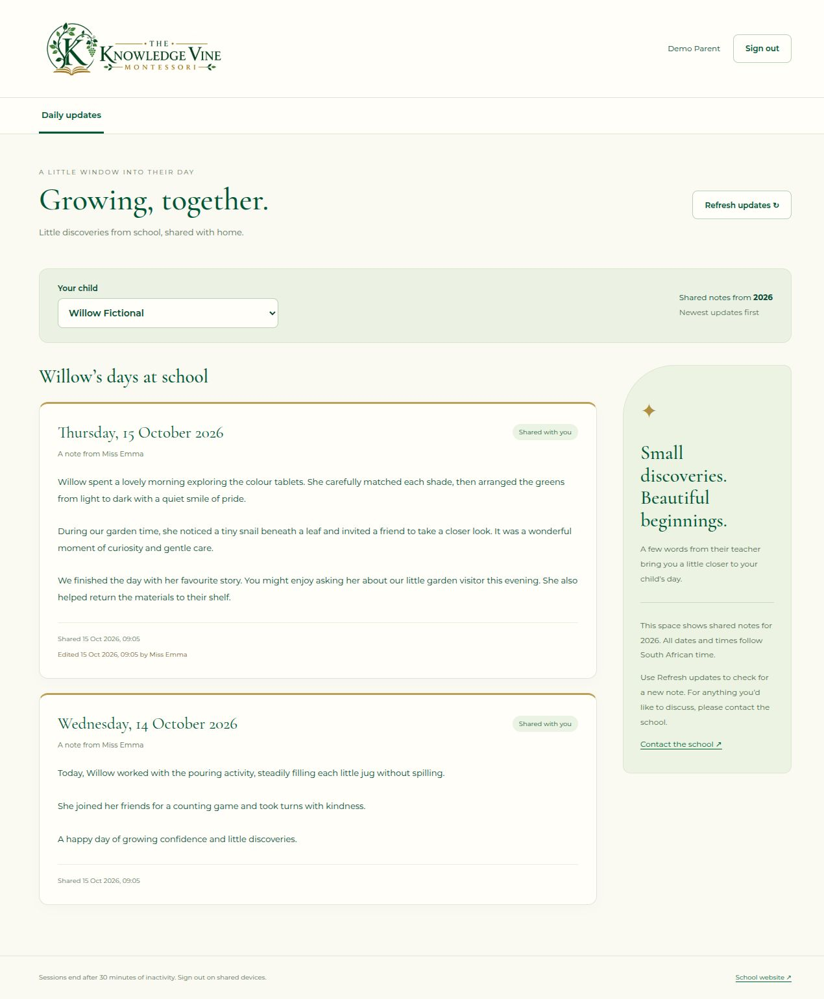
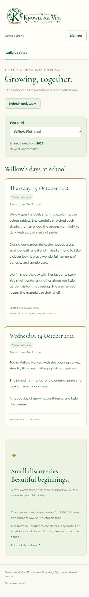
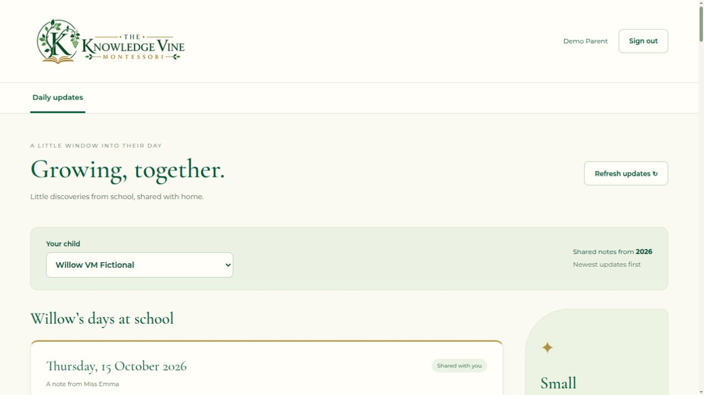
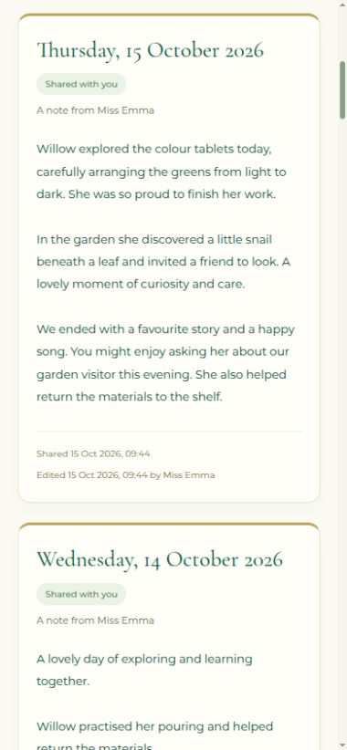

# Step 6: parent daily feed

Implemented locally and **deployed/verified on the testing VM on 15 October 2026**, after the user separately authorized deployment. Steps 1–6 now run in both environments. Future VM deployments continue to require explicit authorization.

## What parents can do

- Sign in through the existing shared login and open `/portal/parent`.
- Switch between their linked, enrolled children.
- Read this South African calendar year's shared notes, newest school date first. Full paragraphs, original teacher, first-share time and any latest correction/editor appear on the cards.
- Refresh updates and load earlier pages. The API defaults to 20 notes per page, caps requests at 50 and uses the last school date as its exclusive `before` cursor. One note per child/date prevents cursor ties.
- See a useful empty state when no child is linked or no note has been shared.

The screen is read-only. Drafts, other families' children and notes from other years are excluded on the server. No email/push notification, read receipt, chat, installation or private offline storage is added in this phase.

## Local manual test

1. Start the local API/frontend using [the development guide](portal-local-development.md), then open [local sign-in](http://localhost:4200/portal/login). Keep the VM on `127.0.0.1:8803` and the laptop on `localhost:4200` so cookies stay separate.
2. As admin, add a **fictional** Parent and Teacher using `.test`/`.invalid` email addresses. Local invitations use private previews; do not enable SMTP for these accounts. Complete password setup manually in a separate browser session. Assign the ready teacher to two fictional children and link both children to the parent.
3. Sign in as teacher and save a draft for one child today. Sign in as parent in another session: the child appears, but the draft does not.
4. Share the note as teacher. Refresh the parent feed: the full note appears with the teacher and shared timestamp. Make a correction, refresh again and check the Edited timestamp/editor. The original author and first-share time remain unchanged.
5. Add another dated shared note. Check newest-first order. Switch children and check the second child's independent empty/feed state. Refresh keeps the chosen child while it remains available.
6. With the parent still signed in, remove one child's parent link or mark that child as no longer enrolled. Refresh the feed or leave/return to the tab: that child disappears, while an enrolled sibling stays accessible. Reusing the old child's API URL must return 404. Its stored notes remain in the database.
7. Use a separate unrelated parent to check family isolation. Admin/Teacher accounts without a Parent role cannot access these parent APIs. An additional Parent role grants no child links automatically.
8. Sign out, or allow the existing 30-minute idle session to expire. Private notes clear. Returning to the feed requires login. Check the phone layout as well.

Account creation/linking is described in [step 4](portal-step-4-testing.md); teacher sharing/corrections in [step 5](portal-step-5-testing.md). Parents do not get a year selector. Previous-year/future-year records, invalid pagination and the exact New Year boundary are checked by the automated fixtures rather than changing the computer/VM clock or real school records.

## Access and refresh behaviour

Every child list, feed page and direct-note API read rechecks the authenticated Parent, setup readiness, parent-child link, current enrollment, shared status and current year as applicable. Actor IDs come only from the authenticated cookie. Individual note IDs do not bypass child/year filtering. Private responses use `Cache-Control: no-store`.

The year runs from 1 January 00:00 to the next 1 January 00:00 in `Africa/Johannesburg`. API responses include server time and the next year boundary. The screen clears/reloads at that boundary using elapsed time rather than the phone's wall clock; pagination cannot mix years. All older notes remain stored.

Refresh, foreground focus and returning to a visible tab recheck access; hiding the tab clears rendered child names/notes. Child switching, failed reads, expiry, sign-out, identity changes and destroyed views discard the displayed feed. Request sequence checks reject late responses from a previous child/account. Notes are not written to localStorage, sessionStorage, IndexedDB or service-worker caches.

Revocation blocks **all subsequent API reads immediately**. A note already delivered to a visible browser cannot be remotely recalled; it clears on the next refresh/focus, hiding the tab, sign-out or expiry. Version one has no polling or real-time push. Background reads do not renew the inactivity window; the existing trusted foreground activity handling is unchanged.

## Database migration

`20261015065839_ParentFeedAccess` is applied to the dedicated **knowledgevine_local** database in both the laptop and testing VM environments. The databases and credentials remain separate. It replaces `portal_parent_updates` using `parent_feed_v2.sql`, adding active-student/current-year filters and rejecting a selected inaccessible child. Its signature and calling-role privileges stay the same. There are no new tables, deleted notes or edits to released migration resources. Down restores only the previous parent function, with no data deletion.

The exported idempotent [schema SQL](../KnowledgeVineAPI/KnowledgeVineAPI/Data/Migrations/portal-schema.sql) includes all three migrations and its KnowledgeVine database-target guard. Normal API startup does not apply migrations. The VM received this migration together with the step-6 API/frontend builds under the user's explicit authorization. Copying the frontend alone is insufficient for a new deployment.

## Verification results

- `python3 scripts/test_portal_database.py`: **127 passed, none skipped**. Runtime SQL tests use rolled-back fictional rows; HTTP tests use connection-local temporary Identity/school tables.
- Frontend headless Chrome suite: **87 passed**.
- Production frontend build: clean, within configured bundle budgets.
- Backend checks cover role/read-only/no-store boundaries, missing/foreign note IDs, drafts, previous/future years, retained history, multiple parents/siblings, departure/unlink, deactivation/role changes, expired cookies, correction metadata, bounded cursor pagination and the exact South African New Year transition at 22:00 UTC on 31 December.
- Frontend checks cover read-only rendering, empty/failure states, stale child/account responses, clearing on expiry/logout/access loss, hidden-tab refresh, pagination/deduplication and year rollover without a trusted device clock.
- Local browser checks verified sign-in, two children, 20→23-note paging, draft/old-year/future-year/unlinked-family exclusion, corrections, an empty sibling feed, departure while signed in, sign-out and responsive layouts at 1280px and 390px. No horizontal overflow was found. Screenshots below use fictional records, removed after verification.

Local development sent no real emails and performed no VM/production/GOTR or backup work. The separately authorized VM deployment and verification are recorded below.

## VM deployment and verification — 15 October 2026

Open [the VM portal](http://127.0.0.1:8803/portal/login), refreshing once to load the new frontend. Use the current account passwords; the original admin was preserved. The existing admin screens can prepare fictional parent/teacher accounts and child links using the onboarding flow above.

- Built framework-dependent Linux x64 API and production Angular artifacts; staged them only in `/home/anrich/KnowledgeVine`. Built the replacement images before stopping the API/web services.
- Applied the guarded idempotent schema as the existing KnowledgeVine migration owner. `ParentFeedAccess` is the third migration. Runtime function execution remained granted; no role/credential provisioning or admin bootstrap was run.
- Recreated only `knowledge-api` and `knowledge-web`. The database container/volume, Dockerfiles, nginx/Compose configuration, appsettings, private environment files and authentication keys were preserved.
- Deployed API/frontend SHA-256 values match the laptop artifacts. Database readiness, nginx validation, deep links and anonymous 401/no-store checks pass.
- Disposable-account API checks through nginx passed for linked siblings, separate families, shared/current-year/direct-note filtering, pagination, read-only/role boundaries, empty feeds and a live teacher correction preserving author/first-share metadata. Leaving school and unlinking immediately denied subsequent child reads; unrelated siblings/families remained accessible. The PostgreSQL helper also enforced enrollment/family rules while retaining all note rows before cleanup.
- Browser checks passed for parent sign-in, child switching, 20→23-note paging, corrections, empty sibling, departure while signed in, sign-out and the 390px phone layout without horizontal overflow. QA used `localhost:8803` in a temporary tab to preserve the user's VM cookies on `127.0.0.1:8803`; the tab was closed and viewport restored afterwards.
- Removed only the three disposable accounts, three fictional children, 27 fictional notes and their links, plus the temporary VM verification tool/staging and both copies of fixture credentials. The VM again contains one original admin, one preexisting student and no daily notes. Every preexisting application-table row fingerprint exactly matches the baseline, as do configuration/key fingerprints and the database container ID.

No real email, production/Erebor/GOTR operation, host service/runtime change or backup/restore work was performed.

| Deployed file | SHA-256 |
| --- | --- |
| `KnowledgeVineAPI.dll` | `d1ff573e75fa45495acba07d15026620db52cb35552096aabd3b47c58707c253` |
| Frontend `index.html` | `6aa001c8e809aa380ba5ed1b7a0127eb7e5a330623c7a53198966c4ceda75e6f` |

