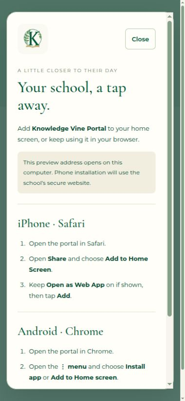
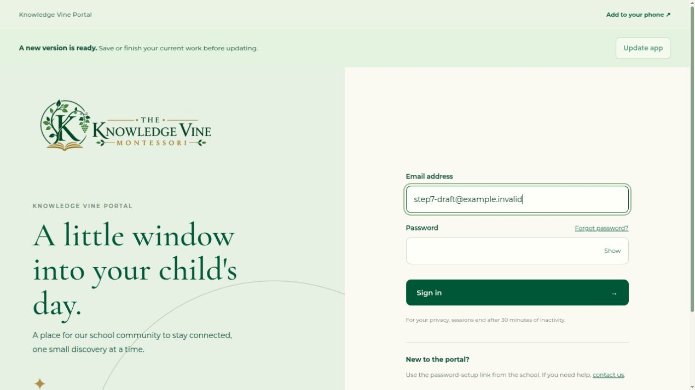

# Step 7: PWA and phone experience

Implemented and deployed to the KnowledgeVine testing VM on **15 October 2026**, with explicit user authorization. Steps 1–7 are now implemented locally and deployed to the VM. The API, database and current accounts remain unchanged by this phase.

## What changed

- **Knowledge Vine Portal** has a standalone web-app manifest. Its stable ID, home-screen launch URL and scope are `/portal/`. Opening it uses the existing role entry/login and server-enforced 30-minute idle session, without a remembered-login option.
- The K, vine and open-book app icon uses the school's cream/green/gold palette. PNG assets cover 192px, 512px, maskable 512px and Apple touch 180px. The editable source is [portal-icon.svg](../knowledevinefront/design/brand/portal-icon.svg); existing website/header branding is unchanged.
- An **Add to your phone** action opens accessible iPhone/Safari and Android/Chrome instructions. A native install button appears only when the browser supplies its install event. Installation is optional and never triggered automatically. Standalone mode hides the action.
- An offline/connection banner explains that notes and account changes need connectivity and that nothing is submitted automatically. Parent feeds clear when connectivity is lost and fetch fresh data when it returns. Teacher text remains only in the current tab; saving/sharing requires an explicit online action.
- A **new version ready** prompt lets the user choose when to update. It never reloads automatically. Unsaved teacher text/recovery, dirty forms, child-link edits, memory-only setup/reset links, account actions and in-flight writes block the update until finished. Reload then loads a complete app version; `activateUpdate()` is not used under an old running bundle.
- Phone inputs use 16px text to avoid focus zoom, controls have at least 44px height and the portal respects screen safe areas. The installation dialog traps/restores focus, supports Escape and scrolls on small screens.

## Preview and actual phones

Open [the VM portal](http://127.0.0.1:8803/portal/login) and refresh once to load the new frontend. Choose **Add to your phone** to review the help.

The VM remains an **HTTP loopback preview**. Loopback is a browser secure-context exception, allowing desktop service-worker/PWA checks here. The preview address points to the current computer and cannot be used as the school's phone installation URL. Actual iPhone/Android installation, standalone launch, phone session/logout/offline behaviour and real installation screenshots remain **step 8**, using a suitable HTTPS preview. No TLS/certificate, host-nginx, public-network or production changes were made for this phase. No native app was installed on the user's computer.

Normal `ng serve` is for development and leaves the service worker disabled. Use a production build served through the VM or an equivalent loopback static server to test PWA caching/updating. First use requires a successful online visit so public app assets can be downloaded.

## Privacy and cache boundary

Angular service worker **20.3.17** matches the existing Angular core version; the framework was not broadly upgraded. Its registration is scoped to `/portal/`, so it does not control public website pages.

`ngsw-config.json` contains a single public asset group: the generic index shell, compiled JavaScript/CSS, manifest, icons and approved logo/favicon. The index contains no server-rendered account or student data. There are **no data groups**, dynamic resource-URL patterns, external font caches, background sync, queued mutations, push subscriptions or notification prompts.

Every same-origin `/api/` request explicitly sets `ngsw-bypass: true`. Existing private API `Cache-Control: no-store` remains enforced. No private portal content is written to browser storage, service-worker caches or offline queues. Session expiry, cookie protections, server authorization and invitation-token rules are unchanged. Background app-version checks do not renew sessions.

VM nginx serves `ngsw-worker.js`, `ngsw.json` and the manifest with revalidation headers. The worker's allowed scope is explicitly `/portal/`. Missing worker/manifest files return 404 instead of the Angular HTML fallback. Existing API routing and private-page headers are preserved.

## Automated verification

From `knowledevinefront`:

```bash
npm run build
CHROME_BIN=/usr/bin/google-chrome npm test -- --watch=false --browsers=ChromeHeadless
CHROME_BIN=/usr/bin/google-chrome npm run test:pwa
```

- **103 frontend tests passed.** They cover supported/declined/absent install events, standalone detection, connection messages, network-only requests, no queued writes, reload blockers, retained teacher text, parent clearing/reconnection and session behaviour through the new interceptor.
- **4 production-worker integration tests passed.** A disposable headless Chrome browser runs the emitted Angular worker against a loopback fake server. Tests verify native portal-only worker activation; public shell caching; exclusion of a private canary response, both with and without the explicit bypass header; no replay of private data during simulated server failure; no queued mutations; and a second manifest version producing `VERSION_READY` without navigating the active client. Cache entries and their bodies are inspected for the canary. No account, real API/database, credential or SMTP connection is used.
- The production frontend build passes bundle budgets without warnings. The existing backend suite remains at 127 passing tests from step 6; no backend code was changed or deployed in step 7.

## VM verification and preservation

- Built/recreated **only the web service**. Updated only its frontend assets and the scoped nginx worker/manifest headers. The API and database containers were not restarted; no migration or admin bootstrap was run.
- The served index, manifest, worker and generated cache manifest match the final laptop build byte for byte. Portal launch/deep links, nginx validation, worker scope/revalidation headers, manifest MIME type, database readiness and anonymous private API 401/no-store checks pass.
- A real browser registered the worker on the VM. Across two successive web deployments, a new version prompt appeared in an already-open tab. With a fictional unfinished login form, **Update app remained disabled**. After leaving that form, it became enabled; clicking it reloaded the new version and cleared the prompt. No login or recovery email was submitted.
- Browser checks verified installation help, focus return, a 390px viewport without horizontal overflow, 16px input text and 44px touch controls. Screenshots below show the actual VM UI; they are not phone-installation screenshots.
- Every preexisting application-row fingerprint, migration, key and private/API configuration matches the predeployment baseline. Both API/database container IDs are unchanged. The sole intended configuration change is the web nginx header block. No test accounts, children or notes were created. Temporary VM staging and test tabs were removed, and the viewport was restored.

No real email, production/Erebor/GOTR, host service/runtime, backup or restore operation was performed. Future VM deployments still require explicit authorization.





## References

- [Angular service-worker cache configuration](https://angular.dev/ecosystem/service-workers/config)
- [Angular update notifications and safe reload](https://angular.dev/ecosystem/service-workers/communications)
- [MDN secure contexts and loopback exceptions](https://developer.mozilla.org/en-US/docs/Web/Security/Defenses/Secure_Contexts)
- [Apple's iPhone home-screen web-app instructions](https://support.apple.com/en-euro/guide/iphone/iphea86e5236/ios)
- [Chrome install prompt and manual fallback](https://web.dev/learn/pwa/installation-prompt)
