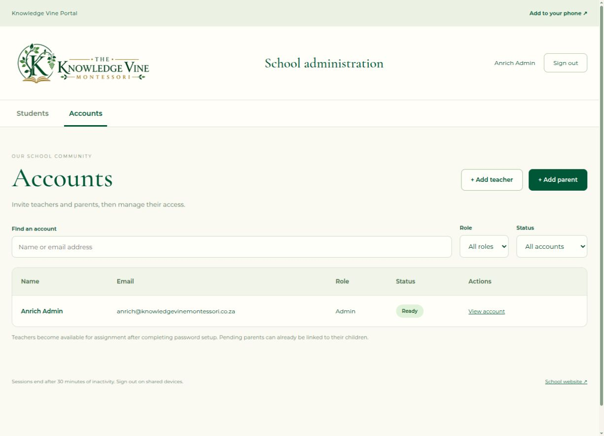

# Step 9: first production deployment

Release **`20261015-114126`**, deployed **15 October 2026 at 14:00 SAST** (12:00 UTC), after the user's explicit authorization. The VM was not accessed or changed.

The live portal is [https://www.knowledgevinemontessori.co.za/portal/login](https://www.knowledgevinemontessori.co.za/portal/login). The original admin is `anrich@knowledgevinemontessori.co.za`, with the initial password supplied privately by the user. No password is recorded here. The production database starts with one ready admin, zero students and zero notes. Development/VM accounts were not copied.

## Deployed layout

| Component | Production value |
| --- | --- |
| Project/root | Compose `knowledgevine`, `/root/KnowledgeVine` |
| API | `knowledge-api`, `knowledgevine-api:20261015-114126`, framework-dependent ASP.NET Core/.NET **10.0.13** |
| Frontend | `knowledge-web`, `knowledgevine-web:20261015-114126`, existing nginx **1.31.6** base retained |
| Database | `knowledge-db`, PostgreSQL **18.6**, database `knowledgevine_live` |
| API/web ports | **127.0.0.1:8082**, **127.0.0.1:8083**; original numbers preserved |
| Database access | Existing KnowledgeVine Docker network only; no published PostgreSQL port |
| Persistence | `knowledgevine-postgres-production` volume; private `.local/production/portal/keys` bind mount |
| Database identities | Restricted `knowledgevine_app`; separate `knowledgevine_migrator`; generated environment-specific credentials |
| Routing | Existing school TLS certificate/domain; school-only X-Forwarded-Proto and explicit loopback upstreams |
| Portal origin | `https://www.knowledgevinemontessori.co.za`; non-www portal redirects to www |
| Mail | Existing school SMTP configuration, Production SMTP mode, previews disabled |
| Resource limits | No hard CPU/RAM limits, as requested |

Database provisioning applied all **three** migrations: **11 tables, 13 functions, 5 triggers, three application roles**. No host PostgreSQL connection/query was made. The application DB login cannot create databases/roles or act as a superuser.

## Validation

- All **131 backend**, **103 frontend** and **5 production-worker** tests passed before publishing. The production Angular build passed its budgets (438.98 kB initial). The portal-scoped worker navigation fix is included.
- Published frontend files match the staged release hashes. `/home`, `/about`, `/contact` and `/portal/login` return 200 over verified HTTPS.
- Unauthenticated session/admin-directory/teacher/parent endpoints return 401 with `no-store`; production API Swagger and development database-health endpoints return 404.
- HTTPS proxy handling produces Secure `__Host-` antiforgery cookies. Manifest MIME type, no-cache worker updates and `/portal/` worker scope were checked.
- Browser sign-in with the original admin succeeded; students and accounts screens showed the expected empty school and ready admin. Browser reload after a targeted API restart preserved the authenticated session and account access. Database container/key fingerprints were unchanged. Installation instructions opened correctly; sign-out was checked afterwards.
- API/web publish only IPv4 loopback. External connection attempts to 8082/8083 failed; the database port is unpublished. Existing school SMTP values were checked without exposing credentials; no real test email was sent.
- No CPU/RAM limits were added. A postrelease sample showed about 39 MiB API, 3.5 MiB web and 47 MiB database usage; this is a point-in-time reading, not a capacity guarantee.

## GOTR preservation

All **four running GOTR active/fallback containers** and the **three stopped legacy containers** retain their original IDs, image IDs, state, start times, restart counts, mount contents, ports, network addresses and runtime-configuration hashes. Mount lists are compared by destination because Docker can return their ordering differently.

GOTR stays on active loopback ports **18080/18081**, fallback **18082/18083**, its own `172.18.0.0/16` network and host PostgreSQL 16/database `gotr`. Its protected application/nginx/PostgreSQL files match their prior fingerprints. Shared nginx, Docker and PostgreSQL cluster process identities/start timestamps remain unchanged. Host nginx was gracefully reloaded, not restarted. GOTR's HTTPS front page returned 200 before and after deployment. No business database records were queried.

The first cutover attempt safely stopped after detecting a mount-order-only difference in a stopped legacy container and restored the school nginx file. The comparison was corrected without weakening mount-content checks; the subsequent deployment and final preservation checks passed.

## Backups and recovery evidence

The user's existing `/home/anrich/dev/backups/knowledgevine/KnowledgeVine` API/frontend archives were validated and match the predeployment Erebor archives exactly. They were retained. An additional complete server snapshot of the prior school app/configuration and preserved image tags are available for rollback.

| Recovery artifact | Location |
| --- | --- |
| Prior site/configuration/image references | `/root/KnowledgeVine/.local/production/releases/20261015-114126/previous/` |
| Preserved image tags | `knowledgevine-api:pre-20261015-114126`, `knowledgevine-web:pre-20261015-114126` |
| Initial DB/key/config backup | `/root/KnowledgeVine/.local/production/backups/20261015-115149` |
| Final DB/key/config backup | `/root/KnowledgeVine/.local/production/backups/20261015-120145` |
| Initial encrypted off-server copy | `/home/anrich/dev/backups/knowledgevine/portal-initial-20261015-114126.enc` |
| Final encrypted off-server copy | `/home/anrich/dev/backups/knowledgevine/portal-live-20261015-114126.enc` |
| Separate private encryption recovery key | `/home/anrich/dev/personal/TheKnowledgeVine/.local/production/backup-encryption.key` |

Both database dumps were restored into disposable **network-isolated** PostgreSQL containers. Restored migrations/users/students/notes/ready-admin counts matched production, and archived keys/private configuration fingerprints matched. Temporary restore containers and their anonymous volumes were removed. Encrypted local copies use authenticated Fernet encryption, with successful decryption round-trip verification; retain the recovery key separately and privately. No GOTR backup/folder/volume was changed.

Backup SHA-256 evidence and restore results are in each protected backup directory. Before/after inventory, cutover and verification JSON are in `.local/production/releases/20261015-114126/` both locally and on Erebor. Do not publish private archives/environment files.

Manual backup/restore-check and scoped rollback instructions are in [the production operator guide](../deploy/production/README.md). **Recurring backups and retention/deletion are not scheduled yet**; agree those before routine school use.

## Remaining before family onboarding

1. Test the real iPhone/Safari and Android/Chrome installation, standalone launch, login/logout, idle timeout and offline behaviour on the live HTTPS portal.
2. Capture actual installation screenshots, finalize the draft PDF and publish/verify `/guides/knowledge-vine-phone-guide.pdf`. Until then the URL returns 404 and `Portal:Mail:InstallationGuideUrl` stays unset; no launch email links to a missing guide.
3. Agree recurring backup timing, off-server handling and retention. Current backups are manually triggered and verified.

The initial browser had a cached predeployment portal response; a one-time release-query URL loaded the new build. Subsequent authenticated deep-link reloads worked normally. If an existing browser still shows the old site, use a fresh/private tab or a full refresh before testing.
